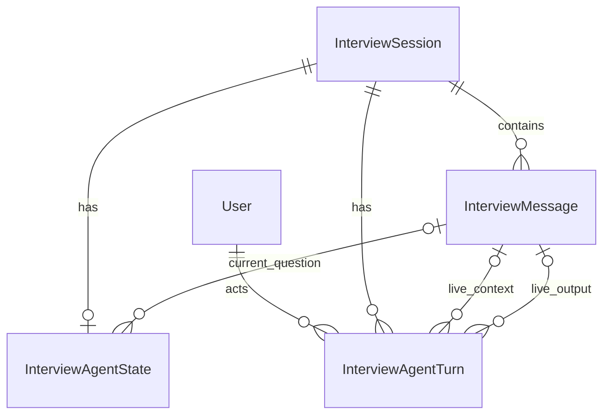
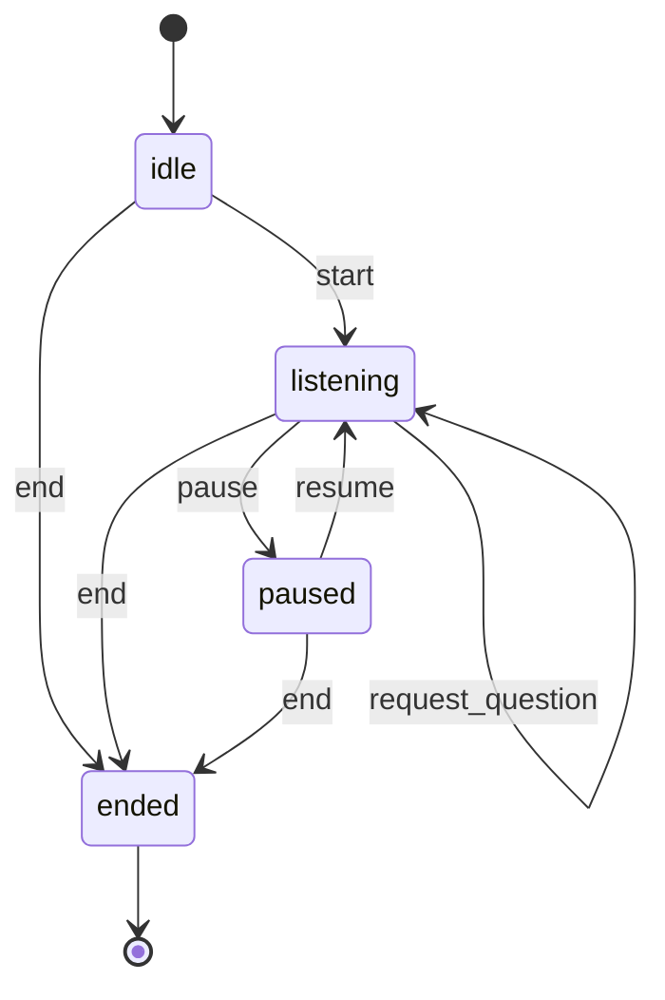
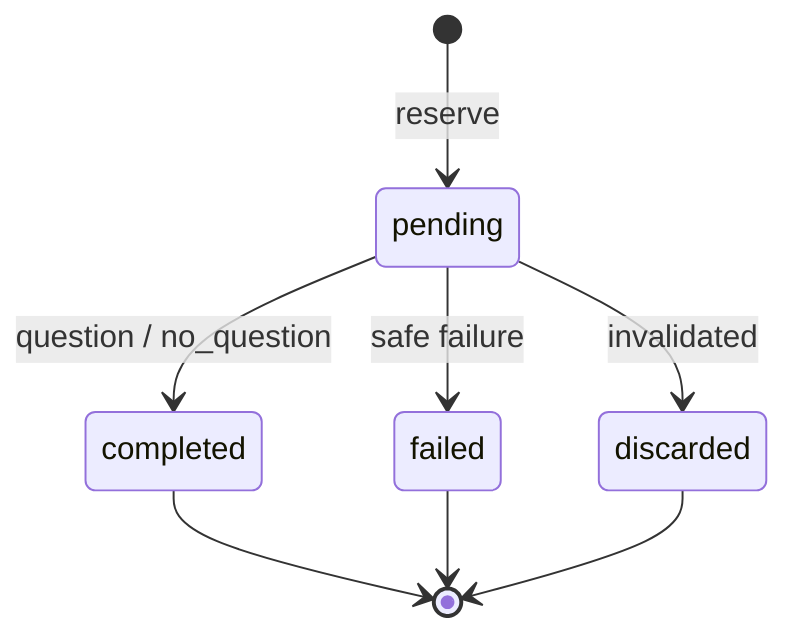

# Part 9.6-A Provider Extension — Scope Freeze + Implementation Contract V1.0

- **版本：V1.0**
- **日期：2026-10-12**
- **Status：IMPLEMENTED**
- **Product Scope：CONFIRMED**
- **Engineering Contract：REVIEW CLARIFICATIONS INCORPORATED**
- **Independent Contract Review（历史）：PASS WITH FINDINGS；六项工程澄清已纳入，原批准条件见 17.2–17.3 历史记录。**
- **Implementation：Completed（Offline Provider Extension）**
- **Implementation Review：PASS**
- **Scope：Offline Provider Extension**
- **Remaining Validation：HTTP/PostgreSQL/Real Provider pending；HTTP/ASGI NOT VERIFIED、PostgreSQL NOT VERIFIED、Real AI Provider NOT IMPLEMENTED**
- **Release：DEVELOPMENT SNAPSHOT ONLY**
- **Baseline：8421f1d725ec6b7e98c6f1a54a52f78d4fdee085**
- **Baseline Note：还依赖现有未提交的 9.6-A 工作区实现；实施前须核验文件 SHA-256。**
- **Document Role：本子阶段详细实施合同的唯一来源；其他文档只保留摘要与引用。**
- **Archive Note：17.2 末尾“本轮未修改项目文件”等声明记录的是首次归档前的合同起草轮次。首次归档新增本文档并追加三个项目文档的摘要与引用；本次工程澄清只修订本合同。**

> 当前状态依据项目 Owner 确认的 Implementation Completed / Independent Review PASS 同步；本轮未复跑测试或审查。以下段落及 0.3、17.2–17.3 保留起草/澄清时的历史状态，已由首页与 17.4 当前记录取代。

> 本合同定义实施范围，不构成代码实施、数据库操作、暂存、提交或推送授权。产品范围已确认；独立合同审查为 PASS WITH FINDINGS，工程澄清已纳入，字段、约束、21 文件白名单、迁移 revision 与 API 等工程设计待实施批准。文档修订不等于 Design Frozen，也不等于 Feature Implemented。

---

## 0. 基线与适用范围

### 0.1 Git 基线

本轮核验的 HEAD：

```text
8421f1d725ec6b7e98c6f1a54a52f78d4fdee085
```

现有 9.6-A 实现位于工作区，尚未提交。因此，实施基线由两部分组成：

1. 上述 Git HEAD；
2. 当前工作区中已经审查的 9.6-A 实现。

进入实施前必须记录相关文件的 SHA-256，核对工作区没有未经审查的变化。不能只依赖 HEAD 判断 Agent 实现内容。

### 0.2 阶段定位

```text
9.6-A：确定性 Mock Agent
    ↓
9.6-A 后续子阶段：Provider Extension，本合同
    ↓
9.6-B：MemoryCandidate + Revision + Human Review
    ↓
9.6-C：获批后的真实 Provider 接入
```

本合同不修改上述路线。

### 0.3 验证边界（合同起草时的历史快照）

本表保留起草时的未实施/未运行记录；当前离线交付与剩余验证状态见首页及 17.4。

| 项目 | 当前状态 |
|---|---|
| 现有 9.6-A | 工作区实现已有 |
| 本 Provider Extension | 未实现 |
| 本合同对应测试 | 未运行 |
| HTTP/ASGI | 未验证 |
| PostgreSQL 迁移、集成、并发 | 未验证 |
| 真实 Provider | 未实现 |
| 真实 Consent 同步 | 未实现 |
| 生产删除传播 | 未实现 |

本合同不能被用于声明生产可用。

---

## 1. 产品范围

### 1.1 已确认决定

| 编号 | 决定 |
|---|---|
| P01 | Provider 扩展属于 9.6-A 后续子阶段 |
| P02 | 允许离线合成 Stub 返回固定题库之外的问题 |
| P03 | start 后先自由讲述；只有用户主动请求才生成问题 |
| P04 | 每次使用当前 Session 最新一条原始文字；Memory Context 为空 |
| P05 | 不新增 GenerationRecord，复用 Turn |
| P06 | pause 只暂停 AI，仍允许保存原始文字；未发布结果不得补发 |
| P07 | 没有原文时允许生成中性开场问题 |
| P08 | 同一原文可被不同请求重复引用，不复制原文、不视为新答案 |
| P09 | end 完成本次 Session；以后继续回忆使用新 Session |

### 1.2 必须实现

- 可替换的离线 Provider 接口。
- 严格的 Request/Result 合同。
- 固定题库之外的合成问题验证。
- 自由讲述生命周期。
- 用户显式请求问题。
- 暂停、恢复、结束控制。
- 已提交结果的幂等重放。
- pending 请求门禁。
- 迟到结果拒绝发布。
- 原文和历史问句的当前用途许可检查。
- Session 完成后的 Message 写入门禁。
- 安全错误响应。
- 一个新增迁移源码。
- 合成离线测试。

### 1.3 不进入本阶段

- 真实个人资料处理。
- 真实 AI Provider、SDK、API Key、网络调用。
- Backend 到 AI Service 的 HTTP transport。
- 录音、STT、Whisper。
- Memory Context、Embedding、RAG。
- MemoryCandidate、Revision、审核。
- Consent 表或授权政策修改。
- C3 Registry、生产 DerivedSource DAG。
- 生产删除、净化、备份清理。
- Worker、消息队列、lease、自动重试。
- Provider 计费或外部调用次数保证。
- PostgreSQL、Docker、迁移执行。
- Git 暂存、提交、推送。

原文不可被修订覆盖，不等于永久保留；既有撤回、删除及保留政策继续适用。

---

## 2. 架构与职责

### 2.1 Backend

保持：

```text
Router → Service → CRUD → Model
```

Backend 负责：

- JWT Actor。
- Owner 隔离。
- Session 与 Agent 状态。
- 来源选择及用途许可检查。
- Turn 和幂等。
- 数据库事务。
- assistant Message 发布。
- 错误脱敏。

CRUD 负责查询、锁、flush，不负责业务状态判断。

### 2.2 AI Service

AI Service 负责：

- Provider 接口。
- Provider Registry。
- 离线问题生成。
- 内容生成合同。

不得处理 Backend 的用户权限、业务事务或数据库写入。

### 2.3 两个应用的边界

```text
Backend InterviewAIClient.next_question
                 ↓ 合同边界
AI Service Interview Agent
                 ↓
AIProvider.generate_question
```

本阶段分别通过离线测试验证两侧，**不实现实际跨服务连接**。

两个应用均使用 `app` 包名，因此：

- 不允许生产 runtime 跨应用 import。
- 不修改 `sys.path` 连接两个应用。
- 双向合同测试只加载独立 Schema，或使用独立进程。
- 不新增第三套合同模块。

---

## 3. 精确文件白名单

**共 21 个文件：16 个现有文件、5 个新文件。**

相较上一版草案，增加 `app/core/exceptions.py`，用于 Agent 路由的错误脱敏。

白名单以当前工作区为增量基线，不能据此暂存全部既有未提交内容。

### 3.1 Backend：13 个现有文件

| 编号 | 文件 | 范围 |
|---|---|---|
| B01 | [models/interview_agent.py](../../apps/backend/app/models/interview_agent.py) | State/Turn 字段及约束 |
| B02 | [schemas/interview_agent.py](../../apps/backend/app/schemas/interview_agent.py) | v2 API 与 wire Schema |
| B03 | [crud/interview_agent.py](../../apps/backend/app/crud/interview_agent.py) | 查询、锁、最小引用、flush |
| B04 | [services/interview_agent.py](../../apps/backend/app/services/interview_agent.py) | 控制、预留、发布、重放 |
| B05 | [services/ai_interview_client.py](../../apps/backend/app/services/ai_interview_client.py) | Client 与默认关闭 |
| B06 | [api/v1/interview_agent.py](../../apps/backend/app/api/v1/interview_agent.py) | API 入口 |
| B07 | [crud/interview_message.py](../../apps/backend/app/crud/interview_message.py) | 共同 Session 锁 |
| B08 | [services/interview_message.py](../../apps/backend/app/services/interview_message.py) | 完成状态写入门禁 |
| B09 | [core/exceptions.py](../../apps/backend/app/core/exceptions.py) | Agent 专用安全错误响应 |
| B10 | [tests/test_interview_agent.py](../../apps/backend/tests/test_interview_agent.py) | 离线流程及事务测试 |
| B11 | [tests/test_interview_agent_api.py](../../apps/backend/tests/test_interview_agent_api.py) | API、JWT、错误合同 |
| B12 | [tests/test_interview_message.py](../../apps/backend/tests/test_interview_message.py) | 原文写入回归 |
| B13 | [tests/test_message_integration.py](../../apps/backend/tests/test_message_integration.py) | 转写复制写入回归 |

### 3.2 Backend：1 个新迁移源码

本合同分配的拟用 revision：

```text
a196e4c72b08
```

拟建文件：

```text
C:/Users/Administrator/Documents/ChatGPT/ai-life-memoir/apps/backend/alembic/versions/a196e4c72b08_interview_agent_provider_extension.py
```

```text
down_revision = f3a96b10d207
```

本轮未发现该 revision 冲突。实施前必须复查；发现冲突时停止，不自行更换 revision。

### 3.3 AI Service：3 个现有文件

- [app/contracts.py](../../services/ai-service/app/contracts.py)
- [app/interview_agent.py](../../services/ai-service/app/interview_agent.py)
- [tests/test_interview_agent.py](../../services/ai-service/tests/test_interview_agent.py)

### 3.4 AI Service：4 个新文件

```text
C:/Users/Administrator/Documents/ChatGPT/ai-life-memoir/services/ai-service/app/providers/__init__.py
C:/Users/Administrator/Documents/ChatGPT/ai-life-memoir/services/ai-service/app/providers/base.py
C:/Users/Administrator/Documents/ChatGPT/ai-life-memoir/services/ai-service/app/providers/mock.py
C:/Users/Administrator/Documents/ChatGPT/ai-life-memoir/services/ai-service/app/providers/registry.py
```

### 3.5 白名单外

不修改：

- `main.py`、`models_import.py`。
- 既有迁移。
- Session、Message 的 Model/Schema。
- C3/BM-01 文件及隔离基础设施。
- workflows、dependencies、配置、前端。
- README、路线图、开发日志。

文档同步和 Git 工作属于后续独立授权。

---

## 4. Domain Model 与数据库合同

### 4.1 实体关系



稳定引用字段保存 Message UUID，不是 C3 Artifact ID，也不代表 Consent。

### 4.2 InterviewAgentState

表名：

```text
interview_agent_states
```

| 字段 | 类型 | Nullable | 约束／说明 |
|---|---|---:|---|
| `session_id` | UUID | 否 | PK；FK Session，CASCADE |
| `contract_version` | String(32) | 否 | v1/v2 |
| `status` | String(32) | 否 | 版本化枚举 |
| `version` | Integer | 否 | ≥0 |
| `generation_epoch` | BigInteger | 否 | ≥0，单调递增 |
| `current_question_message_id` | UUID | 是 | FK Message，SET NULL |
| `last_consumed_answer_id` | UUID | 是 | FK Message，SET NULL；v2 必须 NULL |
| `policy_version` | String(100) | 否 | 服务端策略标签 |
| `created_at` | UTC timestamp | 否 | 保留现有字段 |
| `updated_at` | UTC timestamp | 否 | 保留现有字段 |

State、Turn 的 `contract_version`，以及 Turn 的 `result_state_contract_version`，均使用完整版本字符串：

```text
interview-agent.v1
interview-agent.v2
```

全文的 v1/v2 仅为阅读简写，不是另一套数据库编码。数据库 CHECK、历史回填、API Schema 和 Provider wire 使用同一组完整 literal，不引入隐式映射。

状态：

```text
v1：idle / awaiting_answer / ended
v2：idle / listening / paused / ended
```

规则：

- `contract_version` 创建后不转换。
- 新 State 为 v2、idle、version=0、epoch=0。
- policy 标签不是本人授权证据。
- 成功问题更新 current question 指针。
- pause/resume/no_question 不清除该指针。
- end 清除该指针。
- v2 不再消费答案，不更新 `last_consumed_answer_id`。

### 4.3 InterviewAgentTurn

表名：

```text
interview_agent_turns
```

| 字段 | 类型 | Nullable | 约束／说明 |
|---|---|---:|---|
| `id` | UUID | 否 | PK，服务端生成；同时作为 Provider request_id |
| `session_id` | UUID | 否 | FK Session，CASCADE；index |
| `actor_user_id` | UUID | 否 | FK User，RESTRICT |
| `idempotency_key` | UUID | 否 | Session 内唯一 |
| `contract_version` | String(32) | 否 | v1/v2 |
| `action` | String(32) | 否 | 版本化枚举 |
| `request_fingerprint` | Binary(32) | 否 | 仅身份、ID、请求意图 |
| `reserved_version` | Integer | 是 | v2 非空、≥0；v1 不补认 |
| `reserved_epoch` | BigInteger | 是 | v2 非空、≥0；v1 不补认 |
| `execution_status` | String(32) | 否 | pending/completed/failed/discarded |
| `context_present` | Boolean | 是 | v2 非空；v1 NULL 表示 unknown/not applicable |
| `context_message_id` | UUID | 是 | 当前 FK Message，SET NULL |
| `context_scope_id` | UUID | 是 | 选定原文 UUID 的稳定快照，无 FK |
| `asked_question_message_ids` | JSON UUID array | 是 | v2 非空，最多24个、distinct；v1 NULL |
| `provider_id` | String(64) | 是 | v2 question 请求非空，服务端确定 |
| `input_answer_id` | UUID | 是 | 保留旧 FK/unique；v2 NULL |
| `output_message_id` | UUID | 是 | 当前 FK Message，SET NULL |
| `output_scope_id` | UUID | 是 | 发布成功时写一次的输出 UUID |
| `question_key` | String(100) | 是 | 问题成功时非空 |
| `question_text_normalized` | String(120) | 是 | 仅 legacy 保留；v2 NULL |
| `result_kind` | String(32) | 是 | control/question/no_question |
| `result_state_contract_version` | String(32) | 是 | 成功结果对应 State 版本 |
| `resulting_version` | Integer | 是 | 成功结果快照，≥0 |
| `resulting_status` | String(32) | 是 | 成功结果快照 |
| `failure_code` | String(64) | 是 | 受控错误代码 |
| `discard_reason` | String(64) | 是 | 受控作废原因 |
| `created_at` | UTC timestamp | 否 | 创建时间 |
| `updated_at` | UTC timestamp | 否 | 更新时自动维护 |
| `finished_at` | UTC timestamp | 是 | v2 终态非空；legacy 可未知 |

#### Unique 与 Index

必须包含：

1. `UNIQUE(session_id, idempotency_key)`。
2. 保留 legacy `UNIQUE(input_answer_id)`。
3. 每 Session 最多一个 pending 的部分唯一索引。
4. v2 非空 `output_scope_id` 的唯一索引。
5. `context_message_id` 查询索引。
6. Session＋执行状态查询索引。

本增量的保障层级明确如下：

| 规则 | 数据库源码保障 | Schema / Service 保障 |
|---|---|---|
| FK、UNIQUE、部分唯一索引 | 上述 FK、unique 和 index；执行仍待获授权的 PostgreSQL 验证 | 所有业务写入共用 Session 锁，并进行当前 scope 检查 |
| 版本、状态、动作及结果组合 | 完整版本 literal、版本化枚举、数值范围、fingerprint 长度，以及 4.4 的 NULL / 非 NULL 组合 CHECK | 在写入前和发布前验证对应组合 |
| `asked_question_message_ids` | v2 非 NULL；v1 可 NULL。JSON 的数组形状、UUID 元素、长度及 distinct 本阶段不增加数据库专用 CHECK | 严格数组、0–24 个 canonical UUID 字符串、distinct；在读取和写入时均验证，非法持久化值 fail closed |
| 依赖同 Session、有效顺序、无循环及当前许可 | 本阶段不新增 JSON 依赖的数据库触发器或 DAG 保护 | Service 按 7.4 核验；Provider DTO 使用严格且不可变的集合 |
| 不可变、write-once 和终态不重执行 | 本阶段不新增旧值比较触发器；FK 的 SET NULL 和约束继续有效 | 由 Service 在锁内限制写入路径，不提供改写这些字段或恢复终态的 API |

上述 Service-only 规则不构成直接 SQL 写入保护。不得把 Schema / Service 离线测试写成 PostgreSQL 约束、触发器或并发验收已通过。

#### 不可变与 write-once

创建后不可修改：

```text
id
session_id
actor_user_id
idempotency_key
contract_version
action
request_fingerprint
reserved_version
reserved_epoch
context_present
context_scope_id
asked_question_message_ids
provider_id
```

成功发布时写一次：

```text
output_scope_id
question_key
result_kind
result_state_contract_version
resulting_version
resulting_status
```

执行状态进入终态后不可再执行。

活 FK 允许因删除变为 NULL；稳定 ID 不能因此被清空或换成其他来源。

### 4.4 组合约束

所有 CHECK 必须显式处理 `IS NULL/IS NOT NULL`，不能依赖 SQL 的 UNKNOWN 拒绝非法组合。

#### Pending

必须：

- action=request_question；
- 无结果、输出、失败代码、作废原因、finished_at。

#### Failed

必须：

- action=request_question；
- failure_code、finished_at 非空；
- 无成功结果和输出；
- discard_reason=NULL。

#### Discarded

必须：

- action=request_question；
- discard_reason、finished_at 非空；
- 无成功结果和输出；
- failure_code=NULL。

#### Completed control

必须：

- action 属于 start/pause/resume/end；
- 无 Provider、原文、问句历史或输出；
- 结果快照、finished_at 非空。

v2 control 的空上下文写法固定为：

```text
context_present=false
context_message_id=NULL
context_scope_id=NULL
asked_question_message_ids=[]
provider_id=NULL
```

“无问句历史”使用空数组，不使用 NULL；NULL 仅保留给 legacy 的 unknown / not applicable 表达。

控制 Turn 的 reserved version/epoch 记录动作执行前的值。

#### Completed no_question

必须：

- action=request_question；
- 无输出和 question_key；
- 结果快照、finished_at 非空；
- 不推进 State version。

#### Completed question

必须：

- action=request_question；
- question_key、output_scope_id、结果快照、finished_at 非空；
- 发布事务必须创建真实 output_message_id。

**永久 CHECK 不得要求 output_message_id 始终非空。**

删除后允许：

```text
result_kind = question
output_scope_id = 原 UUID
output_message_id = NULL
```

此时重放不可用，不能复原问题。

#### Context

v2：

```text
context_present=false
    → 两个 context ID 均 NULL

context_present=true
    → context_scope_id 非空
    → live FK 可以非空，也可以因删除变 NULL
```

活 FK 非空时必须与稳定 ID 相同。

---

## 5. 生命周期与版本规则

### 5.1 Agent 状态机



`pending Turn` 表示生成中。Agent 不持久化 generating/waiting_answer。

### 5.2 动作表

| 动作 | 起始状态 | 最终状态 | Provider | version | epoch |
|---|---|---|---:|---:|---:|
| start | idle | listening | 0 | +1 | 不变 |
| request_question 成功问题 | listening | listening | 1 | +1 | 不变 |
| request_question 无问题 | listening | listening | 1 | 不变 | 不变 |
| pause | listening | paused | 0 | +1 | +1 |
| resume | paused | listening | 0 | +1 | +1 |
| end | idle/listening/paused | ended | 0 | +1 | +1 |

失败、作废及预留不自行推进 Agent version。

新 key 重复执行不符合起始状态的动作，返回冲突，不创建新 Turn。

### 5.3 Session 规则

- 保存文字不调用 Provider。
- Session active 时允许保存文字，不要求 Agent 正等待答案。
- pause 后 Session 保持 active。
- end 同事务设置：

```text
Agent.status = ended
Session.status = completed
Session.ended_at = 当前 UTC
```

- 不自动结束 Interview。
- 不自动删除资料。
- 不自动生成候选 Memory。
- 不自动创建下一 Session。
- start 可以在 `started_at` 未设置时记录当前 UTC；不覆盖既有开始时间。

同 key end 重放不得重复修改 ended_at。

### 5.4 问题数量

```text
MAX_QUESTIONS = 24
```

只统计成功发布的 v2 question Turn，包括后来输出已被删除的记录。

不统计：

- 控制动作。
- failed/discarded。
- no_question。

达到上限后新 question 请求返回冲突；pause/end 仍可执行。

### 5.5 Turn 状态机



控制动作直接创建 completed Turn。

终态：

```text
completed / failed / discarded
```

不支持终态恢复为 pending。

---

## 6. 执行、暂停与失败合同

### 6.1 Phase 1：预留短事务

按顺序：

1. JWT Actor 与 Owner scope。
2. 锁定 Session 父行。
3. 查询同 key Turn。
4. 有旧 Turn 时进入重放，不选择新来源。
5. 检查 Session、Agent、expected version、legacy 条件。
6. 检查 pending 唯一门禁及问题上限。
7. 查询最新 user/text 的 ID 和最小元数据。
8. 查询实际准备使用的历史问句 ID。
9. 核验这些输入及依赖来源的用途许可。
10. 许可通过后读取正文。
11. 创建 pending Turn及不可变 Request DTO。
12. 提交并释放事务、行锁。

预留不写 assistant，不推进 version。

### 6.2 Phase 2：事务外调用

```python
client.next_question(request)
```

要求：

- 不持有数据库事务或锁。
- 不在阶段之间访问导致自动开启事务的过期 ORM 属性。
- 不把 ORM、DB Session、JWT 或 credentials 传给 Provider。
- DTO 的集合采用不可变结构；JSON 表现仍为数组。
- 只调用注入的离线 Stub。

若调用前已经观察到 Turn 作废，不能继续调用。

本合同不承诺能中断已经开始的同步函数。pause 的正确性由服务端持久化失效保证。

### 6.3 Phase 3：发布短事务

重新查询并锁定 Session、State、Turn，刷新 ORM 状态。

必须同时满足：

- Owner scope 仍有效；
- Turn pending；
- Session active；
- Agent listening；
- reserved version/epoch 与当前一致；
- 当前策略仍允许；
- 原文及实际发送的历史问句仍存在、可使用；
- 原文与本次 Request 的内容一致；
- 实际发送的历史问句 `(message_id, question_key, text)` 与内存不可变 Request DTO 一致；读取当前正文前重新核验许可，读取时刷新缓存状态；
- Result 绑定、结构及去重通过。

成功问题同事务：

```text
创建 assistant Message
设置 output FK 与稳定 ID
推进 State version
设置 current question
Turn → completed/question
```

no_question 同事务完成 Turn，不修改业务状态。

来源或实际发送的历史问句缺失、变化或不再获许可时，不发布问题；将仍 pending 的本 Turn 按失效原因终结为 discarded，不重调 Provider，不保存正文快照或正文 hash。此规则同样适用于 no_question 的发布复核。

### 6.4 暂停与结束

pause/end 的独立短事务：

- 核验 Owner 和版本；
- 更新 State；
- 递增 epoch；
- 将 pending Turn 标 discarded；
- end 同时完成 Session；
- 提交。

不得读取原文或调用 Provider。

Provider 或 AI 政策不可用，不能阻止安全控制动作。

### 6.5 竞争顺序

以事务成功提交为界：

| 顺序 | 结果 |
|---|---|
| pause/end 先提交 | 旧结果不能发布 |
| 发布先提交 | 问题已发布，不撤销该成功事实 |
| pause→resume 后旧结果返回 | 仍作废 |
| 新文字在生成中保存 | 不更换已选上下文，不自动再生成 |
| Session 删除后返回结果 | 不创建输出；不能复活 Session |

### 6.6 保存失败

已确认失败：

- 回滚全部发布写入。
- 不留下半写入 assistant。
- 不推进 Agent version。
- 可以另开短事务把仍 pending 的本 Turn 标 failed。
- 不能覆盖已被 pause/end 标 discarded 的状态。

失败收尾也失败时，允许保留 pending，报告未完成收尾。

### 6.7 不确定提交

预留、发布或控制动作 `start / pause / resume / end` 的 commit 结果不确定时：

1. 在独立、可信的读回事务中，重新核验 Owner 并查询原 key/Turn；
2. 确认已经提交则使用原状态；
3. 确认未提交才报告相应失败；
4. 无法确认时保持关闭，返回安全不可用错误。

不能通过重新调用 Provider“试一次”。

不能盲目重做控制动作。只有确认原事务结果及读回结果的权威性后才能认定提交成功或失败；仅看到暂时不存在的 Turn 不足以确认未提交。无法确认时返回 `503 / AGENT_COMMIT_UNCERTAIN`。

例如 end 已提交但响应丢失，按原 key 返回已经提交的 completed/control 结果；不再次推进 version/epoch，不重写 ended_at，不重复作废其他 Turn。

### 6.8 崩溃与 retry

- pending 不证明 Provider 尚未执行。
- 同 key pending 不重入。
- failed/discarded 同 key 不重入。
- 不自动重试、扫描、恢复。
- orphan pending 由用户显式 pause/end 作废。
- 用户恢复后用新 key 请求，属于新逻辑请求。

本合同不保证真实 Provider 不重复收费。

---

## 7. 上下文、依赖与幂等

### 7.1 原文选择

只选择：

```text
当前 Session
role=user
source=text
sequence 最大
```

最多一条。

不使用：

```text
audio_transcript
assistant/system
其他 Session
其他档案
Memory
历史 user 原文列表
```

最新原文为空、过长或不可使用时失败，不退回更早原文。

无原文时才使用零来源上下文。

### 7.2 同一原文重复使用

不同 Turn 可引用相同 Message。

不得：

- 创建新的 user Message；
- 标记答案“已消费”；
- 更新 v2 last_consumed_answer_id；
- 因 unique input_answer_id 拒绝再次引用。

### 7.3 已提问列表

只包含当前 Session 已发布且当前允许使用的 v2 assistant 问题。

读取正文前必须核验该问题及依赖来源。

`asked_questions` 用于避免重复，不是新的事实来源。

不能从 `question_text_normalized` 恢复历史问句。

### 7.4 稳定依赖引用

新增两个最小字段：

```text
asked_question_message_ids
output_scope_id
```

前者记录预留时实际发送的历史问句 ID；后者支持输出删除后的稳定定位。

通过历史问句稳定 ID找到对应 Turn，再沿：

```text
context_scope_id
asked_question_message_ids
```

核验依赖闭包。

要求：

- visited 集合；
- 最多24个已发布问题；
- 同 Session；
- 依赖先后顺序按同 Session 的 `InterviewMessage.sequence` 核验；不以 created_at 的大小或相等作为唯一依据；
- 无循环；
- 缺失、跨 scope、无法解释的 legacy 依赖均 fail closed。

许可闭包可以包含多个来源 ID，但不读取多个历史 user 正文。

对已发布问题对应的 Turn，每条历史问句依赖的 Message.sequence 必须小于该 Turn 的输出 Message.sequence。当前 pending Turn 尚无输出时，先核验实际发送的问句均来自既有合法发布记录，并检查这些记录的依赖闭包；若将发布新问题，分配的新输出 sequence 必须大于本次引用的历史问句。没有输出的 no_question 不创建输出顺序边，但仍复核原输入及历史依赖。

不得重排既有 sequence。无法找到用于核验的记录、依赖逆序或循环时 fail closed；不新增顺序字段、正文副本或正文 hash。

这些只是 Agent 的最小依赖引用，不代表完整 C3 provenance 或删除传播。

### 7.5 Fingerprint

v2 fingerprint 仅使用：

```text
actor_user_id
session_id
contract_version
action
expected_version
```

统一 canonical JSON 后 SHA-256，长度32 bytes。

不包含：

- 原文或正文 hash；
- Provider 响应；
- 最新原文自动选择结果；
- token、credentials；
- Memory。

比较使用 constant-time 方法。

### 7.6 重放顺序

1. 当前 Owner scope。
2. 同 key Turn。
3. fingerprint 一致。
4. 按 execution status 处理。
5. 需要返回成功问题结果时重新核验当前来源及依赖许可。
6. 核验真实输出仍存在。

不先检查“当前 version 必须等于旧 expected version”，否则成功重试会失效。

### 7.7 重放行为

| Turn 状态 | 行为 |
|---|---|
| pending | 返回 pending，零 Provider 调用 |
| completed control | 返回原结果，零副作用 |
| completed no_question | 核验当前处理许可后返回原结果 |
| completed question | 核验当前许可及输出后返回 |
| failed | 返回原安全失败，零 Provider 调用 |
| discarded | 返回作废结果，零 Provider 调用 |

控制结果重放不依赖 AI Provider/Consent 能力。

Turn 的 resulting status/version 是历史快照，不是当前 State；客户端不能用旧重放快照覆盖新状态。

### 7.8 M01

若原 Turn 表示 question，但：

- output FK 已置空；或
- 实际输出不存在；

返回：

```text
409 IDEMPOTENCY_RESULT_UNAVAILABLE
```

不能：

- 返回成功无输出；
- 重新生成；
- 从规范化副本复原；
- 重新选择 latest；
- 重新发布旧文本。

---

## 8. Provider Wire Contract

### 8.1 固定版本

```text
contract_version = interview-agent.v2
policy_version = synthetic-mock.v1
```

保留现有合成策略标签。该标签不代表本人 Consent。

所有对象：

- `extra="forbid"`；
- 冻结；
- 内部集合不可变；
- 数字字段 strict，拒绝 Boolean 作为整数；
- JSON 数组双向兼容。

### 8.2 QuestionRequest

| 字段 | 类型 | 约束 |
|---|---|---|
| `contract_version` | literal | v2 |
| `request_id` | UUID | Turn.id |
| `session_id` | UUID | 服务端确定 |
| `policy_version` | literal | synthetic-mock.v1 |
| `agent_version` | int | ≥0 |
| `generation_epoch` | int | ≥0 |
| `context_message_ids` | UUID array | 0/1 |
| `context_text` | string/null | 非空原文，≤10,000 |
| `asked_questions` | array | ≤24 |

AskedQuestion：

```text
message_id: UUID
question_key: 非空字符串，≤100
text: 非空字符串，≤120
```

配对：

```text
context IDs=[]
    → context_text=null

context IDs=[id]
    → context_text为该来源完整原文
```

不增加 topic、confidence、family_member_id、Memory 或 credential。

### 8.3 QuestionResult

| 字段 | 类型／规则 |
|---|---|
| `contract_version` | 回显 v2 |
| `request_id` | 必须等于本 Turn |
| `session_id` | 必须等于 Request |
| `policy_version` | 必须匹配 |
| `agent_version` | 必须匹配预留值 |
| `generation_epoch` | 必须匹配预留值 |
| `context_message_ids` | 必须完整匹配输入 |
| `outcome` | question/no_question |
| `question_key` | string/null，≤100 |
| `question` | string/null，≤120 |
| `question_basis` | neutral/follow_up/null |
| `basis_message_ids` | UUID array，0/1 |

#### Question / neutral

- key/question 非空；
- basis IDs=[]；
- 不预设未经支持的具体人生经历。

存在输入原文时也可返回中性问题，但仍回显原输入 ID，不能抹掉处理依赖。

#### Question / follow_up

- key/question 非空；
- 输入恰好一条；
- basis IDs 精确等于该原文 ID；
- 不得引用历史 assistant 作为事实来源。

#### No question

```text
outcome=no_question
question_key=null
question=null
question_basis=null
basis_message_ids=[]
```

输入绑定仍完整回显，不结束 Session。

### 8.4 Backend 校验

Backend 独立校验结构和绑定，不信任 Provider 自述安全。

允许固定题库之外的合法合成问题。

不能继续要求：

```text
(question_key, question) 必须属于 QUESTION_CATALOG
```

### 8.5 去重

沿用：

```text
NFKC
casefold
去空白
去标点
```

拒绝：

- 当前 Session 全部成功发布的 v2 question Turn 中已使用的 question key，包括输出已删除或受限的记录；只比对稳定业务 key 元数据，不读取其正文；
- 当前存在、获许可且实际纳入 asked_questions 的历史问句中，规范化后相同的文本。

不承诺对已删除或受限正文进行文本去重，也不承诺识别近义重复。不为去重恢复、读取或复制已不可用正文，不保存规范化正文或正文 fingerprint。

### 8.6 Registry

- 固定服务端 allowlist。
- 无客户端 Provider 选择。
- 无任意动态 import。
- 无 URL、SDK、Key。
- 未知 Provider fail closed。
- 不自动 fallback 到 Mock。

默认 Backend ProcessingDecision/Client 保持关闭。只有合成测试可显式注入。

### 8.7 超时边界

Stub 的 `TimeoutError` 映射：

```text
503 AI_PROVIDER_TIMEOUT
```

此测试只证明分类，不证明真实计时、中断或取消同步函数。


## 9. REST API Contract

### 9.1 状态读取

```http
GET /api/v1/sessions/{session_id}/agent-state
```

Actor：Owner。

响应：

```text
session_id
contract_version
status
version
generation_epoch
session_status
pending_turn_id
current_question_message_id
```

无 State、无 Agent 历史时返回虚拟 v2 idle/version0/epoch0，不写数据库。

发现 Turn 存在但 State 缺失等异常图，返回安全冲突，不伪造正常状态。

只读元数据不调用 Provider，不读取正文。

### 9.2 动作入口

```http
POST /api/v1/sessions/{session_id}/agent-turns
Idempotency-Key: <UUID>
```

请求：

```json
{
  "contract_version": "interview-agent.v2",
  "action": "request_question",
  "expected_version": 3
}
```

动作：

```text
start / request_question / pause / resume / end
```

禁止请求包含：

```text
user_id
provider
model
context IDs/text
answer_message_id
consent
Memory
credential
```

新请求同步执行；不创建后台任务。

| 情况 | HTTP |
|---|---:|
| 新动作成功 | 201 |
| 成功幂等重放 | 200 |
| 同 key pending | 202 |
| 版本/状态/key 冲突 | 409 |
| 非法输入 | 422 |
| Provider 结果非法 | 502 |
| Provider/政策/存储不可用 | 503 |

响应含 Turn 元数据、结果类型、结果版本及 output Message ID，不包含正文副本。

### 9.3 Turn 状态读取

```http
GET /api/v1/sessions/{session_id}/agent-turns/{turn_id}
```

Actor：Owner。

返回：

```text
id
session_id
contract_version
action
execution_status
result_kind
result_state_contract_version
resulting_version
resulting_status
output_message_id
failure_code
discard_reason
created_at
finished_at
```

这里只查询操作元数据，返回 Message ID 不授予正文访问。

不存在和跨 Owner 统一404。

#### API 版本与 nullable 规则

- State 和 Turn 元数据的版本字段使用 4.2 中的完整 literal。
- State.status 按自身版本校验：v1 为 idle/awaiting_answer/ended，v2 为 idle/listening/paused/ended；结果快照按 `result_state_contract_version` 校验，不能仅依据 Turn.contract_version。
- pending/failed/discarded Turn 的 `result_kind`、`result_state_contract_version`、`resulting_version`、`resulting_status` 和 `output_message_id` 允许为 NULL；不得填入伪造成功值。
- completed Turn 的结果快照非 NULL；completed control/no_question 的输出为 NULL。completed question 的活输出 FK 删除后可为 NULL，重放仍执行 M01。
- v2 终态 finished_at 非 NULL；legacy finished_at 允许未知。`failure_code` / `discard_reason` 按执行状态可为 NULL。
- Legacy 显式 v2 end 的 Turn.contract_version 为 interview-agent.v2，result_state_contract_version 为 interview-agent.v1，快照状态为 ended。
- POST 与 GET 使用相同的元数据字段和状态校验规则；历史结果快照不能被当成当前 State。

### 9.4 错误代码

| 代码 | HTTP |
|---|---:|
| `NOT_FOUND` | 404 |
| `INVALID_AGENT_REQUEST` | 422 |
| `AGENT_VERSION_CONFLICT` | 409 |
| `AGENT_STATE_CONFLICT` | 409 |
| `SESSION_NOT_ACTIVE` | 409 |
| `LEGACY_AGENT_SESSION` | 409 |
| `AGENT_STATE_UNAVAILABLE` | 409 |
| `AGENT_GENERATION_PENDING` | 409 |
| `AGENT_QUESTION_LIMIT` | 409 |
| `IDEMPOTENCY_CONFLICT` | 409 |
| `IDEMPOTENCY_RESULT_UNAVAILABLE` | 409 |
| `AGENT_RESULT_DISCARDED` | 409 |
| `SOURCE_UNAVAILABLE` | 409 |
| `PROCESSING_DENIED` | 403 |
| `POLICY_UNAVAILABLE` | 503 |
| `AI_INVALID_RESPONSE` | 502 |
| `AI_PROVIDER_TIMEOUT` | 503 |
| `AI_UNAVAILABLE` | 503 |
| `AGENT_STORAGE_UNAVAILABLE` | 503 |
| `AGENT_COMMIT_UNCERTAIN` | 503 |
| `AGENT_INTERNAL_ERROR` | 500 |

失败和作废原因仅存受控枚举，不存异常字符串。

---

## 10. 授权与错误安全

### 10.1 权限矩阵

本增量沿用现有 Owner-only 内容接口，不提前实现家庭协作内容权限。

| 操作 | Owner | Collaborator／非 Owner Speaker |
|---|---|---|
| 最小 Agent 元数据读取 | 允许 | 不新增权限 |
| start/pause/resume/end | 允许 | 不新增权限 |
| request_question | Owner＋当前处理许可 | 不新增权限 |
| 成功问题重放 | Owner＋当前依赖许可 | 不新增权限 |
| 修改 Consent | 本阶段无此功能 | 本阶段无此功能 |

Operator/Actor 身份不能替代 Speaker/Consenter。

Mock 许可不能被客户端提交，不能成为生产 Consent。

### 10.2 读取顺序

```text
Actor/Owner
→ ID/scope
→ 当前处理许可
→ 正文
→ Provider
```

不能先读取原文，再判断许可。

### 10.3 Agent 错误脱敏

只针对 Agent 路由：

```text
/api/v1/sessions/<非空路径段>/agent-state
/api/v1/sessions/<非空路径段>/agent-turns
/api/v1/sessions/<非空路径段>/agent-turns/<非空路径段>
```

路径匹配不能要求 UUID 已合法，否则非法 UUID 的422仍会回显。

要求：

- 固定422响应。
- 不包含 input、ctx、请求值或 ValidationError详情。
- Agent AppException 只输出受控代码及固定消息。
- 未处理异常固定500。
- 日志只记录固定事件类别。
- 不记录原始 path、query、headers、body、SQL参数或异常堆栈。
- 保留必要的标准认证行为。
- 其他路由错误处理保持原状。

Service 的 Provider/DB 异常必须转换为安全 AppException，`details=None`，禁止把原始异常传入日志。

#### DEBUG 模式与局部异常包装

- 固定错误规则必须在 DEBUG=True 和 DEBUG=False 下均成立，不依赖全局 Exception handler 足以覆盖调试 traceback。
- B06 的 Agent Router 使用专用 APIRoute 包装，覆盖请求解析、依赖求解、endpoint 调用及响应序列化的异常。在调试错误中间件生成响应前，由 B09 的安全错误处理输出受控 422 / AppException / 500。
- 保留标准认证的固定错误与必要认证响应头；不得把原始异常、输入值或 traceback 交给响应或日志。
- 仅 Agent 路由采用该包装；不修改 main.py、配置 DEBUG 值或其他路由的错误行为。
- T40/T41 必须有对局部包装的离线验证，覆盖依赖及响应序列化敏感异常；直接调用固定 handler 不能替代这部分证据。完整 ASGI 请求链的执行状态仍按 13.4 单独报告。

### 10.4 数据最小化

新 Turn 不保存：

```text
原文副本
Prompt
Provider response 正文
question_text_normalized
正文 hash
token/API Key
```

问题正文只作为成功的 assistant Message 保存。

稳定 UUID、question_key 和依赖引用仍是受保护的业务元数据，不能称为匿名审计。

---

## 11. Migration 与历史兼容

### 11.1 迁移顺序

新增迁移源码依次设计：

1. 新增允许过渡 NULL 的字段。
2. 现有 State/Turn 标 v1。
3. 现有 Turn 标 completed。
4. 保留原 action/status/version/fingerprint。
5. 按旧输出意图回填 result_kind。
6. 已存在 output FK 可回填稳定输出 ID；已丢失 ID不伪造。
7. legacy 新 context 字段保持 unknown。
8. 添加版本化 CHECK、索引和 v2 非空组合要求。
9. 新 ORM 默认值使用 v2。

不执行 migration。

### 11.2 Legacy State

禁止自动转换：

```text
awaiting_answer → listening
ended → Session completed
idle → listening
```

### 11.3 V2 eligible Session

必须：

```text
Session active
不存在 v1 State
不存在 v1 Turn
```

这不表示来源已授权。

### 11.4 Legacy API

- 旧格式 v1 mutation 不再执行。
- 历史 Turn通过最小元数据GET查询。
- 不通过 v2 请求重解释 v1 的 start/answer/skip。
- 不提供旧规范化正文恢复。
- v2 的 M01 防复活规则必须保留。

唯一例外：Owner 对 active Legacy Session 显式提交 v2 end。

同事务：

```text
State保持v1
State.status=ended
version/epoch推进
Session completed
写入v2 completed/control Turn
result_state_contract_version=v1
```

同 key 重放无副作用。新 key 对已完成 Session 再 end 返回冲突。

异常历史图不自动修复，不补认授权。

### 11.5 Downgrade

- 不静默删除 v2 Turn/State。
- 存在 v2 数据时拒绝有损 downgrade。
- 不通过降级重新开放 completed Session。
- 数据回退需要独立方案。

---

## 12. Message 写入合同

当前三个运行时写入入口：

1. 原始文字；
2. TranscriptSegment → Message；
3. Agent assistant 发布。

必须共用同一 Session 父行锁。

Service 顺序：

```text
锁定并刷新Session
→ Owner确认
→ 检查Session active
→ 检查本入口业务条件
→ 分配sequence并flush
→ commit
```

不能使用锁前缓存的 active 状态。

保留现有：

```text
UNIQUE(session_id, sequence)
```

不得重排已有 sequence。

本阶段不允许 Agent 把 `audio_transcript` 当上下文，但必须防止已有转写复制入口在 Session 完成后继续新增 Message。

Session 锁不能证明生产 Consent 撤回与删除事务已经同步；该能力仍属于后续阶段。

---

## 13. 测试与验收

### 13.1 必需测试矩阵

| ID | 用例 |
|---|---|
| T01 | 跨 Owner 的 State/Turn/Message 隔离 |
| T02 | start 零 Provider 调用 |
| T03 | 保存文字零 Provider 调用 |
| T04 | 无原文中性首问 |
| T05 | 最新一条 user/text 选择 |
| T06 | 其他 Session/role/source 不进入上下文 |
| T07 | 同原文跨 Turn 重用，无 user Message复制 |
| T08 | 固定题库之外合成问题成功 |
| T09 | Request/Result 双向JSON兼容；API 元数据版本、状态联合及 nullable 组合 |
| T10 | 额外字段、v1/v2混用、错误绑定拒绝 |
| T11 | neutral/follow_up/no_question 组合 |
| T12 | 当前合法历史正文的规范化去重；已删除/受限输出的已发布 key 仍拒绝复用 |
| T13 | 不宣称近义句去重 |
| T14 | 单 pending 门禁 |
| T15 | 同 key pending 零再次调用 |
| T16 | completed 重放，latest变化不改原上下文 |
| T17 | 同 key 不同intent冲突 |
| T18 | failed/discarded 为终态 |
| T19 | pause 后文字可保存 |
| T20 | pause先提交，迟到结果零发布 |
| T21 | pause→resume 不补发 |
| T22 | end原子完成Session，不完成Interview |
| T23 | end后文字/转写复制/assistant均拒绝 |
| T24 | 发布先提交与控制先提交顺序 |
| T25 | Provider/政策不可用仍能停止 |
| T26 | 保存失败无半写入、无version推进 |
| T27 | 失败收尾不覆盖discarded |
| T28 | 预留/发布/控制事务不确定 commit 对账；不重调 Provider 或重复控制副作用 |
| T29 | orphan pending无自动恢复 |
| T30 | 原文删除/变化/许可失效阻止发布 |
| T31 | 历史问句依赖许可、发布前 DTO 一致性及重放复核 |
| T32 | 缺失依赖、逆序、循环、跨scope fail closed；顺序使用 Message.sequence |
| T33 | M01输出删除后409，不能正文复原 |
| T34 | no_question保持State/Session |
| T35 | 问题上限不阻挡pause/end |
| T36 | legacy无自动状态转换 |
| T37 | legacy显式end与幂等 |
| T38 | 默认关闭、未知Provider无fallback |
| T39 | TimeoutError/非法结果错误分类 |
| T40 | 误传answer/token、非法JSON/UUID不回显 |
| T41 | Provider/DB/依赖/响应序列化异常不泄露敏感标记；DEBUG 两模式的局部包装单元验证 |
| T42 | 实际Provider调用期间无DB事务/锁 |

### 13.2 离线隔离要求

授权实施验证后：

- 先安装 guard，再导入应用。
- 禁用 dotenv、Secret文件及真实DB连接。
- 清理子进程继承环境。
- 禁用 pytest 插件自动加载。
- 使用独立内存 SQLite fixture。
- 禁止 socket和网络。
- 禁止裸跑全仓 pytest。
- 禁止调用现有 provisioning。
- 不能通过放松 BM-01让测试通过。

可使用阻塞/回调 Stub按确定顺序验证暂停，不需要真实网络或 Worker。

### 13.3 示例验证入口

以下为**实施获批后的命令设计，本轮未执行**：

```powershell
& $validationPython -I -B "C:\Users\Administrator\Documents\ChatGPT\ai-life-memoir\apps\backend\tests\test_interview_agent.py"

& $validationPython -I -B "C:\Users\Administrator\Documents\ChatGPT\ai-life-memoir\services\ai-service\tests\test_interview_agent.py"
```

API/Message新增离线用例通过 Backend guard入口选择执行。不得借此执行依赖真实 conftest 的 HTTP/DB 用例。

Lint/format仅针对白名单 Python文件：

```text
ruff check --no-cache
ruff format --check --no-cache
```

不自动修复或格式化白名单外文件。

### 13.4 验收层级

| 层级 | 本阶段要求 |
|---|---|
| Schema/Service/Stub离线测试 | 必须通过 |
| T40/T41 局部错误合同 | Schema、路径匹配、handler、Agent 专用包装的离线用例必须通过；不代表完整 HTTP 请求链 |
| Ruff/Format | 必须通过 |
| 迁移源码静态审查 | 必须通过 |
| HTTP/ASGI | 未授权或未运行时明确NOT RUN |
| PostgreSQL迁移/并发 | 本合同不执行，明确NOT VERIFIED |
| 真实Provider | NOT IMPLEMENTED |
| 真实数据库清理 | N/A，未创建资源 |

不允许把离线通过写成全量Fast、HTTP或PostgreSQL通过。

T40 的非法 JSON / UUID 用例须分别注明是 Schema / 验证异常 / 局部包装单元证据，还是实际 ASGI 解析链证据。T41 同样区分局部异常包装与实际请求链。未获授权或未执行的 ASGI 子项保持 NOT RUN，不以人工构造异常冒充真实请求执行。

数据库 CHECK / index 的源码静态审查与 Service-only 校验分开报告；PostgreSQL 直接写入、约束执行、并发及迁移仍为 NOT VERIFIED。

---

## 14. 实施顺序与 Codex Prompt

### 14.1 实施顺序

| 步骤 | 文件范围 | 数据库设计 |
|---|---|---|
| I1 合同Schema | Backend Schema、AI contracts、合同测试 | 无 |
| I2 Model/迁移源码 | Agent Model、新migration | State/Turn扩展，仅源码 |
| I3 控制动作 | CRUD/Service/API | 控制Turn、Session完成 |
| I4 生成与重放 | Agent Service、Client、测试 | pending与发布事务 |
| I5 Message门禁 | Message CRUD/Service及测试 | 无新增表 |
| I6 Provider | AI providers/agent/tests | 无 |
| I7 错误脱敏 | exceptions/API tests | 无 |
| I8 验证与审查 | 白名单测试和只读diff | 不执行PostgreSQL |

I8完成不自动授权文档同步或Git。

### 14.2 可直接使用的实施 Prompt

```text
实施 Part 9.6-A Provider Extension，严格遵循已批准的
Scope Freeze + Implementation Contract V1.0。

开始前：
1. 阅读根和Backend AGENTS。
2. 核验HEAD及现有未提交9.6-A。
3. 记录并核对基线文件hash。
4. 核对白名单21文件及migration revision不存在冲突。
5. 确认staging为空并保留既有工作区内容。

只实现：
- v2 Provider wire contract；
- 自由讲述与显式request_question；
- State/Turn扩展；
- reserve → 锁外同步Stub → publish；
- pause/resume/end；
- 当前来源及历史问句依赖许可；
- 幂等、M01、迟到结果门禁；
- Session完成后的三个Message写入门禁；
- Agent局部错误脱敏；
- 本合同已纳入的六项工程澄清，包括 DEBUG 局部包装、去重边界、控制提交对账、版本/nullable、依赖顺序与 DTO 一致性、验证证据层级；
- 一个新增migration源码；
- 获授权的合成离线测试。

保持：
- Router → Service → CRUD → Model；
- Owner-only现有权限；
- 默认ProcessingDecision关闭；
- operator不代表speaker/consenter；
- Backend和AI Service runtime隔离；
- legacy历史语义。

禁止：
- 真实资料、Provider、SDK、网络、语音、Memory；
- C3/C4/删除pipeline实现；
- 新GenerationRecord、Worker、自动retry；
- 原文/Prompt/响应正文审计副本；
- 修改既有migration；
- PostgreSQL、Docker、迁移执行；
- Git add/commit/push/reset/restore/clean；
- 修改白名单外文件。

范围不足或基线变化时：
报告具体差异，停止依赖该差异的工作，不自行扩大范围。

最终报告：
- 实际修改文件；
- 数据库源码变化；
- 各层测试证据；
- NOT RUN/NOT VERIFIED项目；
- 安全状态；
- 未解决发现；
- 是否READY FOR IMPLEMENTATION AUDIT。
```

---

## 15. 独立审查与批准条件

独立审查必须覆盖：

1. 产品P01–P09无偏移。
2. 原文输入始终最多一条。
3. DTO、绑定和依赖引用一致。
4. pause能够独立提交。
5. 不存在迟到结果复活。
6. 同 key不重复调用。
7. 输出FK置空仍可删除且M01成立。
8. 三个Message写入口均有完成门禁。
9. legacy不补认来源/Consent。
10. 默认关闭不被控制动作豁免误扩展。
11. 错误响应及日志无敏感回显。
12. 不把Agent引用称为生产Provenance。
13. 不把SQLite称为PostgreSQL并发证据。
14. migration仅源码、父链正确。
15. 文件变动仅在批准白名单内。

发现风险应依据可证明的影响分级；不能只因某项测试失败就标为 Critical。

---

## 16. Git 与工作区保护

本合同不授权Git写操作。

必须保留：

```text
16个历史模板删除：unstaged
ad：untracked
apps/backend/.env.test：ignored，不读取内容
既有C3/BM-01及9.6-A修改：保留
```

未来暂存/提交须独立审计。

因为原9.6-A仍未提交，后续提交文件集合可能包含它的既有前置文件；不能直接把本合同21文件当成Git提交白名单。

---

## 17. 完成条件与状态声明

### 17.1 离线增量完成条件

只有以下全部满足，才可声明本增量离线实现完成：

- 白名单实现完成；
- 合成测试通过；
- lint/format通过；
- 迁移源码审查通过；
- 独立实施审查通过；
- 无阻塞发现；
- 默认生产处理关闭；
- 未运行项目准确列出；
- 工作区保护通过。

仍不得声明：

```text
真实AI完成
Consent完成
生产删除完成
HTTP验证完成
PostgreSQL验证完成
Production Ready
```

### 17.2 合同状态（起草与审批前的历史快照）

```text
PRODUCT SCOPE CONFIRMED
IMPLEMENTATION CONTRACT V1.0 COMPLETE DRAFT
INDEPENDENT CONTRACT REVIEW PASS WITH FINDINGS
ENGINEERING CLARIFICATIONS INCORPORATED
READY FOR IMPLEMENTATION APPROVAL
IMPLEMENTATION NOT STARTED
```

本合同已完整列出实施范围与技术规则。**独立审查通过并获得实施批准后，才可进入代码阶段。**

本轮未修改项目文件、运行测试、操作数据库或修改Git；暂存区仍为空。

### 17.3 独立审查工程澄清记录（2026-10-12，实施前历史记录）

| 编号 | 纳入的澄清 | 对应条款 |
|---|---|---|
| E01 | DEBUG 两模式下 Agent 专用异常包装及固定错误输出 | 10.3、T40/T41 |
| E02 | 全部已发布 key 与当前合法正文的去重范围分开 | 8.5、T12 |
| E03 | 不确定提交对账覆盖预留、发布和全部控制动作 | 6.7、T28 |
| E04 | 完整版本 literal、控制空上下文、API nullable；数据库与 Service 保障层级 | 4.2–4.4、9.3、13.4、T09 |
| E05 | Message.sequence 依赖顺序及历史问句发布前 DTO 一致性 | 6.3、7.4、T31/T32 |
| E06 | 单元验证、局部包装、完整 ASGI 与 PostgreSQL 证据分别报告 | 10.3、13.4、T40/T41 |

本次只补充工程表述，保留 P01–P09、21 文件实施白名单、29 个 Turn 字段和 T01–T42 编号。未新增产品权限、Consent 或删除政策，也未新增实体或扩大实施范围。

本记录不构成代码、测试、迁移执行或 Git 写操作批准。只有用户另行明确批准实施后，才可按本合同开始离线增量开发；实施仍为 NOT STARTED。

本轮实际操作仅修改本合同文档；未修改 runtime、Model、Migration、测试、配置或 workflow，未运行测试，未操作数据库 / Docker，也未暂存、提交或推送。

### 17.4 当前实施与文档同步状态（2026-10-12）

本节依据项目 Owner 确认的实施完成与独立审查 PASS 更新，仅同步文档状态；本轮未重新执行实施测试或独立审查，不新增测试计数、迁移成功或远端 CI 证据。

| 项目 | 当前状态 |
| --- | --- |
| Status | IMPLEMENTED |
| Implementation | Completed |
| Implementation Review / Independent Review | PASS / PASS |
| Scope | Offline Provider Extension |
| HTTP/ASGI | NOT VERIFIED（完整请求链沿用 NOT RUN 记录） |
| PostgreSQL 迁移、集成、并发 | NOT VERIFIED |
| Real AI Provider | NOT IMPLEMENTED |
| Release | DEVELOPMENT SNAPSHOT ONLY |
| 下一阶段 | Part 9.6-B Candidate + Revision + Human Review |

已完成 Provider Contract v2、Offline Mock Provider、Agent transaction separation、Pause/Resume/End lifecycle 与 Message lifecycle protection。真实 Consent 同步与生产删除传播仍沿用原未实现边界；源码或离线审查结论不构成生产可用声明。

**历史状态保留：**首页此前为 `REVIEWED DRAFT — PENDING IMPLEMENTATION APPROVAL` / `Implementation：NOT STARTED`，Engineering Contract 为 `REVIEW CLARIFICATIONS INCORPORATED — PENDING APPROVAL`；这些状态属于已完成的起草与审批前阶段。Independent Contract Review 的 PASS WITH FINDINGS 和 E01–E06 工程澄清、17.2 起草快照及 17.3 历史记录均保留；当前 Implementation Review PASS 不覆盖或删除历史审查。

**L01：**v1 duplicate end semantics issue 继续作为 9.6A-L01 历史发现独立跟踪；当前 v2 新 key 重复 end 被拒绝，同 key 幂等重放保留，本轮不关闭 L01。

**本轮操作边界：**仅同步 README、开发日志、路线图与本合同。Git：no add / no commit / no push，未执行 reset / restore / clean；Database：no operation；Docker：no operation；未执行 migration，未读取 .env 或 secret，未修改业务代码。完成后停止，不进入 Git Commit。
