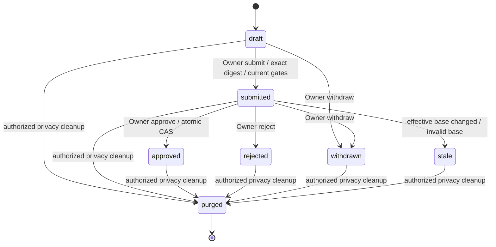
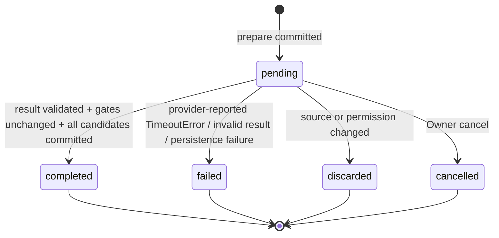

# Part 9.6-B — Candidate + Immutable Revision + Human Review
# Product Scope + Approval / API / Migration / Acceptance Contract V1.0

| Metadata | Value |
| --- | --- |
| Date | 2026-10-12（Asia/Shanghai） |
| Status | APPROVED OFFLINE CONTRACT；IMPLEMENTED LOCALLY；SCOPED REVIEW PASS WITH FINDINGS |
| Product decisions | CONFIRMED |
| Part | 9.6-B |
| Implementation | 已授权的42文件离线实施写入工作区；NOT COMMITTED / NOT SEALED；57项全覆盖未完成 |
| Baseline | master @ 6c12e96e4f83ada7cb7c7dd60fec4283269f8700 |
| Baseline message | feat(interview): add provider extension for interview agent |
| Baseline class | DEVELOPMENT SNAPSHOT ONLY |
| Documentation operation | 2026-10-14同步实际验证与独立复核状态；不授予暂存/提交/推送批准 |
| Detailed SSOT | 本文；README、路线图、开发日志和 ADR 只保留摘要与引用 |
| Release | NOT PRODUCTION READY |

**PRODUCT SCOPE CONFIRMED != DESIGN FROZEN != FEATURE IMPLEMENTED。**

## 2026-10-14 — 9.6-B 验证闭环状态（最新）

- 已批准的42文件离线实施写入工作区，未提交；B-IR-01～04 经「9.6-A Review」独立复核 CLOSED。
- 独立复核：**PASS WITH FINDINGS**；详细记录见 [闭环独立复核报告](../05_开发阶段记录/Part9.6-B_Validation-Closure_Independent-Review_2026-10-14.md)。
- HTTP/ASGI：现有合成用例 **15 passed / 3.67s**，每例独立内存SQLite；不证明生产JWT、真实Consent或真实Provider流程。
- PostgreSQL16.15：现有专项 **28 passed / 2.68s**，fresh upgrade与前后current/check通过；含5个真实双连接用例。
- Legacy/downgrade：**18个脚本验收场景**通过，不是18个pytest用例；原ID、正文、FK和时间保留，新增authority不补造；空库/纯Legacy可安全回退，测试的不安全回退被拒绝且schema/row快照不变。
- 本次成功及失败隔离run的临时库与角色均已核验清理，原HBA恢复；旧v3仍UNKNOWN，与本次资源分开。
- **E-01 Medium（证据限制，非已确认业务缺陷）**：57项不能由测试数量相加推断全部完成。B32既有Memory两提案竞争、B33 ordinal并发、B52预检后新增引用的指定真实PG场景仍未验证；真实Legacy孤儿、版本化Section等回退分支未单独覆盖。
- 真实Provider、完整生产Consent/C3/C5/C6、备份与第三方清除仍未实现/验证；不关闭BM-01，不标Production Ready或整个9.6-B Sealed。
- 下一门禁：**Git Commit Review 的只读 Pre-Commit Audit**；精确白名单与差异审计后仍需用户分别批准暂存、提交、推送。暂存区为空，16个历史删除/AGENTS/C3/BM-01/ad/.env.test均不得意外纳入。


本文源于此前《审批、API、迁移与验收合同草案 V1.0》。修订合同随后通过定向合同复核并获用户批准42文件离线实施；当前实现与验证状态以首页及文末最新记录为准。正文中“拟实施/待批准/本轮不运行”的措辞保留原合同授权边界与历史阶段语境；不由归档自动授予任何新操作权限。本次不改变产品决定、字段、状态机或API合同。

本文不替代 [Root AGENTS](../../AGENTS.md)、[Backend AGENTS](../../apps/backend/AGENTS.md)、[9.5.5-C Design Freeze](../03_业务流程/Part9.5.5-C_Family-Collaboration-Participant-Consent_Design-Freeze_V1.0.md)。既有 C 生产授权、撤回、删除及保留政策继续有效。

## 1. 已确认产品决定

| ID | 决定 |
| --- | --- |
| P01 | Candidate 为来源支持的结构化人生片段：正文＋可选时间、地点、情感；保留讲述者风格、主观态度、矛盾和不确定性，不补剧情。 |
| P02 | Owner 显式选择一条 role=user、source=text 的 Message 进行 AI 提取，输出 0–N Candidate；转写与跨消息提取后置。 |
| P03 | 保存文字、结束 Session 不自动触发提取；完成 Session 不需要为后续整理重新打开。 |
| P04 | 同一来源重跑创建新批次和新 Candidate；不自动匹配、合并、覆盖人工修订或正式 Memory。 |
| P05 | Candidate 批准只创建新 Memory；已有 Memory 修改走其人工 Revision，不通过候选替换或合并。 |
| P06 | 保留人工录入；新建与编辑都形成不可变 Revision，Owner 明确批准具体版本后生效。Owner 自己创建也不自动批准。 |
| P07 | 新 Memoir 章节绑定精确已批准 Memory Revision 与批准 proof；Memory 后续编辑不自动修改旧章节。 |
| P08 | 历史 Memory / MemoirSection 保留为 Legacy，不补造历史审批、作者、讲述者、Consent 或精确版本来源。 |
| P09 | Owner 最终批准；Speaker / Collaborator 的纠错权、本人授权/撤回/删除权沿用 C。B 运行接口先保持 Owner-only，不能声称相关协作内容入口已实现。 |
| P10 | 使用明确的离线 Memory 审批 profile：先绑定业务 Revision，同一套 RevisionProposal 状态机；真实处理默认关闭，后续原地接入 C3/C5 Artifact；不建平行审批权威。 |
| P11 | 本阶段合成数据＋离线 Provider；不接网络、真实资料、生产环境、RAG、Embedding、语音或真实 STT。 |

“批准”表示 Owner 认可精确整理版本，不是认证客观历史真相，也不代表 Speaker 已授权。无法来源支持的可选事实使用 NULL；不把未知值改成虚构日期、地点、人物或情绪。主观/不确定叙述可以被明确标识地保留；不能将缺乏支持的确定断言变成正式事实。

### 1.1 当前代码基线

- 已有人工 Memory：单一非空 source_message_id，原始 user/text 或 user/audio_transcript 校验，Owner-only CRUD；PATCH 当前直接覆盖字段。
- 已有 Memoir：确定性 title/content 快照，仅 draft；章节关联 memory_id，尚无 Revision / proof。
- 已有 Interview Agent v2：离线 Provider 合同、幂等、锁外调用；这些不等于 Memory 提取。
- SourceArtifact 是 dormant C3 ORM，未注册生产 metadata，kind 仅四种原始内容类型。不存在可直接调用的正式 C3 Registry、C4 Consent、C5 RevisionProposal 或 C6 清理流水线。
- 当前迁移源码链 head 为 a196e4c72b08；未读取或声明实际数据库版本。

相关代码：[Memory Model](../../apps/backend/app/models/memory.py)、[Memory Service](../../apps/backend/app/services/memory.py)、[Memoir Model](../../apps/backend/app/models/memoir.py)、[Memoir Service](../../apps/backend/app/services/memoir.py)、[Command Idempotency](../../apps/backend/app/services/command_idempotency.py)。

## 2. 架构与 C5 profile 补充

### 2.1 单一审批权威

- ContentRevision 只保存不可变内容及其依赖，不另设 authoritative approved 布尔值。
- RevisionProposal 是唯一提交/审批载体；审计事件与命令记录不能独立使正文生效。
- Memory 当前指针同时指定 Revision 和批准 Proposal。
- 提取输出不是自动确认的 Memory。
- 人工新建先保存 origin=manual 的待审 Candidate＋Revision＋draft Proposal；该 Candidate 是待审片段身份，并不表示 AI 生成。

### 2.2 Profile 与完整 C 的明确差异

本阶段仅创建 revision_proposals 的 offline_memory.v1 profile：

1. input_revision_id 是真实业务 FK。
2. 不创建指向不存在 source_artifacts 表的 FK；不写 placeholder Artifact UUID。
3. C5 的 target_artifact_id / revision_artifact_id 完整生产绑定尚未接入。本阶段不通过 nullable 空 FK 声称它们有效，而是明确采用业务绑定 profile。
4. Proposal 的 payload 正文不复制到第二个 JSON 列；正文只在 ContentRevision。完整 C 的 payload 字段如未来接入，应继续避免重复正文权威。
5. 后续 C3/C5 使用同一 Proposal ID / Revision ID 原地升级，不保留第二张审批表。
6. 后续必须独立完成 Artifact kind 扩展、kind/entity/scope 双向一致性、来源/贡献 DAG、真实 Speaker / Consent epoch、约束验证，才增加生产 Artifact FK/unique 与 profile。仅补 artifact_id 不算完成。
7. 不改变 C 既定 Owner、Speaker、撤回、删除或保留期限政策。

### 2.3 ERD

~~~mermaid
erDiagram
    User ||--o{ Family : owns
    Family ||--o{ FamilyMember : contains
    FamilyMember ||--o{ Interview : subject
    Interview ||--o{ InterviewSession : contains
    InterviewSession ||--o{ InterviewMessage : contains
    InterviewSession ||--o{ AudioRecording : contains
    AudioRecording ||--o{ Transcript : produces
    Transcript ||--o{ TranscriptSegment : contains
    TranscriptSegment o|--o{ InterviewMessage : copied_into
    User ||--o{ ExtractionBatch : requests
    InterviewMessage ||--o{ ExtractionBatch : input
    ExtractionBatch o|--o{ MemoryCandidate : produces
    InterviewMessage ||--o{ MemoryCandidate : supports
    FamilyMember ||--o{ MemoryCandidate : subject
    MemoryCandidate o|--o{ ContentRevision : owns_candidate_revisions
    Memory o|--o{ ContentRevision : owns_memory_revisions
    ContentRevision o|--o{ ContentRevision : parent_or_origin
    ContentRevision ||--o| RevisionProposal : reviewed_input
    MemoryCandidate o|--o{ RevisionProposal : candidate_target
    Memory o|--o{ RevisionProposal : memory_target
    RevisionProposal o|--o| ContentRevision : approved_output
    MemoryCandidate o|--o| Memory : promoted_once
    Memory ||--o| ContentRevision : current_content
    RevisionProposal o|--o{ Memory : current_proof
    FamilyMember ||--o{ Memory : subject
    InterviewMessage ||--o{ Memory : evidence
    FamilyMember ||--o{ Memoir : subject
    Memoir ||--o{ MemoirSection : contains
    Memory ||--o{ MemoirSection : identity
    ContentRevision o|--o{ MemoirSection : exact_version
    RevisionProposal o|--o{ MemoirSection : exact_proof
~~~

ERD 是逻辑关系；candidate_id / memory_id XOR、复合 FK、NULL 分支与 C3 后续接入以 §3 为准。User 是唯一账号/rights 主体体系。FamilyMember、调用 actor、Message.role、文中提到的人名都不能被自动认定为真实 Speaker。

## 3. Table Specification（待审工程字段）

### 3.1 通用类型与保障层

- U=UUID；T=TIMESTAMPTZ；V=BIGINT；J=JSONB（SQLite 测试映射 JSON）；D=BYTEA＋CHECK octet_length(value)=32（SQLite 映射 binary＋length CHECK），不是 PostgreSQL 不支持的 BYTEA(32)。
- 所有主键 U 非空，服务端生成；created_at T 非空、UTC、不可改写；updated_at T 非空，仅服务端更新元数据。
- 所有新增 User / FamilyMember / Message / Revision / Proposal 真实 FK 使用 RESTRICT；不新增 CASCADE 清理正文捷径。
- batch→Session FK 也使用 RESTRICT。既有 MemoirSection→Memoir CASCADE 保持原行为，不构成 C6 删除传播。
- 各 scope 字段由 backend 从来源链派生，不信任客户端。
- DB 保证 FK、unique、range、状态/NULL 组合；Service 保证 Owner、body immutable、合法转换、digest、用途闭包及当前权限。
- 普通业务禁止改写正文/源/父版本/作者/指纹。未来受控隐私清除可将正文和敏感摘要清空，保留受 Policy 约束的最小 tombstone；本阶段仅合成 fixture 模拟，不公开 purge API。

### 3.2 memory_extraction_batches — ExtractionBatch

| 字段 | 类型 / nullable | 约束与含义 |
| --- | --- | --- |
| id | U / NO | PK；Provider request_id |
| requested_by_user_id | U / NO | User FK；operator，不等于 Speaker |
| session_id | U / NO | Session FK |
| family_member_id | U / NO | subject FK |
| family_scope_id | U / NO | 稳定 scope；服务端确认 live Family owner |
| source_message_id | U / NO | Message FK；本 Session 单一 user/text |
| source_scope_id | U / NO | 稳定源 ID；CHECK 等于 source_message_id |
| contract_version | VARCHAR(40) / NO | memory-extraction.v1 |
| policy_version | VARCHAR(100) / NO | synthetic-offline.v1 profile；不是 production Consent |
| permission_stamp | J / NO | §4 服务器 receipt；不含原文、token 或 secret |
| provider_id | VARCHAR(64) / NO | server allowlist：mock |
| request_fingerprint | D / NO | 绑定 actor、operation、source、contract 的 control-only digest |
| idempotency_key | U / NO | UNIQUE(requested_by_user_id,idempotency_key) |
| state | VARCHAR(32) / NO | pending/completed/failed/discarded/cancelled |
| version | V / NO | 初始 0，转换 +1；CHECK >=0 |
| candidate_count | INTEGER / YES | completed 必有 0..20；其他状态 NULL |
| failure_code / discard_reason | VARCHAR(64) / YES | 受控代码；失败/作废组合互斥 |
| created_at / updated_at | T / NO | UTC |
| finished_at | T / YES | pending=NULL，终态非空 |

Index：(session_id,created_at,id)、(source_message_id,state)、(family_member_id,state)。
pending 无候选、终态原因或 finished_at；completed 无 failure/discard；failed 必有 failure_code；discarded 必有 discard_reason；cancelled 原因使用固定 cancelled_by_owner。已完成输出数量与 Candidate 数量在同一事务核验（Service；PG 集成测试验证）。

### 3.3 memory_candidates — MemoryCandidate

| 字段 | 类型 / nullable | 约束与含义 |
| --- | --- | --- |
| id | U / NO | PK |
| family_member_id / family_scope_id | U / NO | subject FK＋稳定 scope |
| source_message_id / source_scope_id | U / NO | 原始 Message FK / 稳定 ID；来源不可换 |
| origin | VARCHAR(32) / NO | extraction/manual |
| batch_id | U / YES | Batch FK；extraction 必有，manual 必空 |
| batch_ordinal | INTEGER / YES | extraction >=1；manual NULL；UNIQUE(batch_id,batch_ordinal) |
| created_by_user_id | U / NO | 当前发起 actor；不代表原始讲述者 |
| version | V / NO | 生效/晋升基准计数，初始 0；仅晋升 +1 |
| revision_counter | V / NO | 正文版本序号计数；新增 Revision +1 |
| promoted_memory_id | U / YES | Memory FK、UNIQUE；晋升写一次 |
| created_at / updated_at | T / NO | UTC |

Index：(family_member_id,created_at,id)、source_message_id、batch_id。
候选未晋升时 promoted_memory_id=NULL；成功晋升后仅通过正式 Memory 创建后续人工 Revision。并行未决 Proposal 可以有多个，但一个 Candidate 最多产生一个正式 Memory。

### 3.4 memory_content_revisions — ContentRevision

| 字段 | 类型 / nullable | 约束与含义 |
| --- | --- | --- |
| id | U / NO | PK |
| candidate_id / memory_id | U / YES | 两个真实 FK，CHECK 恰好一项非空 |
| family_member_id / family_scope_id | U / NO | subject FK / 服务端 scope |
| source_message_id / source_scope_id | U / NO | Message FK / 稳定 ID；与归属一致 |
| ordinal | V / NO | >=1；分别 UNIQUE(candidate_id,ordinal)、UNIQUE(memory_id,ordinal) |
| parent_revision_id | U / YES | 本归属上一内容版本 FK；NULL 为首版或无可验证 Legacy 版本 |
| origin_revision_id | U / YES | 晋升所用 Candidate Revision FK；区别于同归属 parent |
| author_mode | VARCHAR(32) / NO | mock_ai/manual/promotion |
| actor_user_id | U / NO | 业务调用 actor；AI 发起人/审批人，不冒充 Speaker |
| derivation_profile | VARCHAR(64) / NO | raw_manual / ai_derived / transcript_derived / inherited |
| required_purposes | J / NO | 服务器用途依赖集合，沿父/origin闭包继承 |
| input_permission_stamp | J / NO | 创建时真实或本阶段合成 receipt |
| body_state | VARCHAR(16) / NO | present/purged；来源 quarantine 另由 gate 判定 |
| payload | J / YES | present 非空、purged NULL；§5 内容 schema |
| content_digest | D / YES | present 非空、purged NULL；§5.3 HMAC |
| digest_scheme / digest_key_id | VARCHAR(64)/VARCHAR(100) / YES | present 非空；版本化 key 标识不是 secret |
| created_at / updated_at | T / NO | UTC |

候选晋升时创建新的 Memory 归属 Revision：origin_revision_id 指定输入，parent=NULL、ordinal=1。逐字段精确复制 payload/source/purpose依赖；author_mode=promotion 不洗掉 ai_analysis。输出 digest 与输入 digest 相同，因 digest 不含输出身份字段。

Index：两组归属/ordinal、source_message_id、parent_revision_id、origin_revision_id。
候选人工编辑仍继承原 AI 依赖；人工直接从原始文字新建无需自动添加 AI 用途。人工使用 audio_transcript 沿用现有合法原始来源校验，但必须保留 transcription 与其上游依赖；这不开放 AI 转写提取或真实 STT。

### 3.5 revision_proposals — 唯一审批载体

| 字段 | 类型 / nullable | 约束与含义 |
| --- | --- | --- |
| id | U / NO | PK |
| profile | VARCHAR(40) / NO | offline_memory.v1；本 B profile 不允许客户端选生产模式 |
| family_scope_id / family_member_id | U / NO | 稳定 scope / subject FK |
| candidate_id / memory_id | U / YES | 恰一项非空，真实 FK |
| input_revision_id | U / NO | ContentRevision FK、UNIQUE；一内容版本一个提案 |
| proposed_by_user_id | U / NO | User FK |
| base_version | V / NO | 目标生效版本基准，初始 candidate=0 / Legacy Memory=0 |
| base_revision_id | U / YES | Memory target 的当前批准版本；Legacy 无批准时 NULL |
| payload_digest / digest_scheme / digest_key_id | D/VARCHAR(64)/VARCHAR(100) / YES | 非purged时非空，与输入匹配；purged可清空 |
| state | VARCHAR(32) / NO | draft/submitted/approved/rejected/withdrawn/stale/purged |
| version | V / NO | 初始 0，状态变化 +1 |
| submitted_at / decided_at | T / YES | 与状态组合一致 |
| decided_by_user_id | U / YES | User FK；approved/rejected 时当前Owner |
| decision_code | VARCHAR(64) / YES | controlled enum，拒绝可选；不存自由正文备注 |
| approval_permission_stamp | J / YES | approved 必有；当前许可证明不放幂等快照 |
| result_memory_id / result_memory_revision_id | U / YES | approved 必非空；其他非purged状态为空；purged可保留最小关联 |
| created_at / updated_at | T / NO | UTC |

Index：(family_scope_id,state,created_at,id)、(memory_id,state)、(candidate_id,state)。
submitted 后输入、digest、base_version 不改写。结果只写一次；target=memory 时结果 memory_id 必等于目标，结果 Revision 就是该 input_revision_id。target=candidate 时结果为精确复制出来的新 Memory Revision。proposal 的正文只通过 input_revision_id 读取，不另存 payload 副本。

re-consent 后若将来需要重新 Owner 审批：形成新的 Memory Revision＋新 Proposal，不能复活旧 approved Proposal；已晋升 Candidate 不再次晋升。这是 C 恢复后重新审批规则的版本化表达，本阶段没有真实 restore API。

### 3.6 修改既有 Memory / Memoir / CommandIdempotencyRecord

**Memory 保留原 id、family_member_id、source_message_id及其 RESTRICT。新增：**

- record_origin VARCHAR(32) NOT NULL：legacy/versioned；迁移历史=legacy。
- version BIGINT NOT NULL DEFAULT 0（批准生效 +1）；revision_counter BIGINT NOT NULL DEFAULT 0（草稿版本 +1）。
- origin_candidate_id UUID NULL FK Candidate、UNIQUE；防同一 Candidate 建两条 Memory。
- current_revision_id / current_approval_proposal_id UUID NULL，CHECK 同空或同非空。
- 旧 title/content/time_text/place/emotion 改为可空；历史字节保留。新 versioned Memory 旧正文列全部 NULL，不填占位正文。
- record_origin=legacy 是导入历史来源分类，即使后来批准新版本也不补过去审批；current 有效时读取新版本，旧列只走 explicit Legacy snapshot。
- 正常业务不改旧 Legacy 正文；合法 C6 清除例外另管。

**Memoir 新增 record_origin：legacy/versioned。MemoirSection 新增：**

- record_origin：legacy_snapshot/approved_revision_snapshot。
- memory_revision_id / approval_proposal_id UUID NULL，旧行两项均 NULL，新行两项均非空。
- 保留 memory_id RESTRICT、memoir_id CASCADE、position>0，以及 UNIQUE(memoir_id,position)、UNIQUE(memoir_id,memory_id)。
- 新 title/content 是指定 Revision 的确定性副本，不能另行生成/润色；旧副本不反推历史版本。

**CommandIdempotencyRecord：**

- 复用现有唯一索引、request_digest与safe snapshot机制，不新增平行幂等表。
- 新增 fingerprint_scheme VARCHAR(64) NULL、fingerprint_key_id VARCHAR(100) NULL；旧 C2 行均 NULL，旧逻辑不重新指纹化。
- B 含敏感载荷操作使用 §8 HMAC；body-free安全控制使用 scheme=control-sha256.v1、key_id=NULL。
- B 不采用现有 failed_retryable→processing 自动重试规则。提取失败/作废/取消是批次终态；命令完成仅保存该终态的安全结果。C2 原有语义保持。
- 扩展服务的 B operation typed snapshot allowlist，不能将全文模型传给 complete。

### 3.7 精确 FK 闭环

约束名字由新 migration 固定具名；下列目标键先建立 UNIQUE：

1. Revision UNIQUE(id,candidate_id)、UNIQUE(id,memory_id)。
2. Proposal (input_revision_id,candidate_id) → Revision(id,candidate_id)，另一组 (input_revision_id,memory_id) → Revision(id,memory_id)。XOR CHECK 保证必须有一组实际有效，不能依靠 NULL 跳过两组。
3. Proposal (result_memory_revision_id,result_memory_id) → Revision(id,memory_id)；结果同空/同非空。
4. Proposal UNIQUE(id,result_memory_revision_id,result_memory_id)。
5. Memory (current_approval_proposal_id,current_revision_id,id) → Proposal(id,result_memory_revision_id,result_memory_id)。
6. Section (approval_proposal_id,memory_revision_id,memory_id) → Proposal(id,result_memory_revision_id,result_memory_id)，另以 (memory_revision_id,memory_id) → Revision(id,memory_id)。
7. Candidate.promoted_memory_id FK/unique＋Memory.origin_candidate_id FK/unique；Service 校验互指、同subject/source并在同事务写入。
8. Batch、Candidate、Memory 建 UNIQUE(id,family_member_id,source_message_id)。Candidate (batch_id,family_member_id,source_message_id) → Batch 对应键；manual 的 batch=NULL不走批次FK。Revision分别以 (candidate_id,family_member_id,source_message_id)/(memory_id,family_member_id,source_message_id) → Candidate/Memory对应键，XOR确保有效分支；source_scope_id与source_message_id有等值CHECK。
9. Revision另建 UNIQUE(id,candidate_id,family_member_id)、UNIQUE(id,memory_id,family_member_id)；Proposal以 (input_revision_id,candidate_id,family_member_id)/(input_revision_id,memory_id,family_member_id) 对应，补齐subject。稳定family_scope_id由Service对FamilyMember→Family链核验并保持不可改；它不是客户端可写或可独立授权的FK替代物。
10. Revision parent以 (parent_revision_id,candidate_id)/(parent_revision_id,memory_id) → Revision对应键；NULL为首版，非NULL时有效XOR分支必须同归属。Proposal base以 (base_revision_id,memory_id) → Revision(id,memory_id)；candidate target的base_revision_id必须NULL。origin_revision_id仅合法晋升跨归属，Service核验同subject/source/purpose；未来历史恢复克隆使用同Memory的parent，不复用晋升origin语义。
11. Proposal的candidate result必须与Candidate.promoted_memory_id/Memory.origin_candidate_id互指；memory target result必须等于target及input。SQL FK保证真实绑定，state/result/digest/epoch审批语义仍由Service原子验证。

不依赖 PostgreSQL trigger 来补正常服务漏写。DB 不保证 state=approved、正文digest或权限；这些必须在 §7原子事务中验证。循环FK先建表后加；正常写入用 §7同事务分阶段flush，不要求填假正文或提前标批准。


## 4. 来源许可、读取与审批 proof

### 4.1 生产关闭与测试替身

Backend 的 MemoryPolicy/Integrity capability 默认 unavailable。没有通过当前 Source、主体、用途检查时，不读正文、不调用 Provider、不建内容 Revision、不批准、不组装/读取 Memoir 正文。仅服务端测试注入 synthetic fixture DecisionStamp 和 HMAC capability；客户端不能通过 synthetic=true、profile、provider、owner_id、speaker_id、Consent ID 或 epoch 自行开启。

B 不实现真实授权服务或改写 C1/C2 的身份体系。account JWT/rights token 的既有区分继续有效；rights_only Speaker 不因本人权利入口获得 Family 内容或 B 审批 API 访问。Owner、Operator、Speaker、Consenter 是不同概念。

### 4.2 DecisionStamp 合同

服务端内部 receipt 必含：profile、policy_version、operation、actor_user_id、family_scope_id、family_member_id、source_scope_id、source_generation、required_purposes、各必要 purpose_generation，以及 allow/body_available/restore_verified 的结果。值由权威 adapter 提供，不采用客户端声明。保存的 permission_stamp/approval_permission_stamp 去除临时 allow 结果，保留 scope、profile/policy、必要 purpose 与 generation；JSON 不存正文、联系方式、密钥或 token。

operation（extract/manual_revision/submit/approve/read/memoir_use）是调用动作，不是新增 Consent purpose。用途沿用 C：recording、transcription、ai_analysis、family_share/text_derived；原始音频播放分享是独立许可。原始文字的存档提交/告知边界不能伪装成某个已实现 ConsentGrant。

- AI 提取以及人工改写 AI Candidate 的派生版本保留 ai_analysis 依赖。
- 从 audio_transcript 人工整理时保留 transcription 及其上游来源依赖；不能改 author_mode=manual 洗掉依赖。
- 访问受 Family sharing 约束的具体分支，必须检查 family_share/text_derived；不能把 Owner 视为免检。
- 只撤回原始音频播放，不自动视为文本分享/AI 用途失效。许可闭包必须按该内容真实依赖求取，不能粗暴采用全 Family epoch。
- 每次 Provider 调用前、结果发布前、提交审批前、批准事务内、正文读出前、Memoir 创建及后来每次正文读出，都重新校验必要 Source/用途。
- 来源正文已清除、身份/授权不明、generation 不符、用途撤回、恢复未明确核验或 adapter 不可用均 fail closed。不以 Source 当前“allow=true”代替历史明确恢复。
- 合成 receipt 只证明离线行为；旧 Message 的 role/source/FK 不证明讲述者或本人 Consent。

### 4.3 批准与历史版本独立校验

approved 为审计决定，不是永久可读许可。读取正式 Memory 或章节需同时满足：

1. 当前 actor 为该 Family Owner。
2. 指定 Revision body_state=present，digest 有效，Proposal state=approved 且精确指向该 Memory/Revision。
3. 审批 proof 的相关 source/purpose generation 与当前仍一致；当前必要用途允许。
4. 不处于隔离、待删除、已删除或未核验恢复；所有祖先来源与必要用途闭包有效。

审批以后编辑 Memory 不使旧 Memoir snapshot 自动变化；但 Source/必要用途变化仍限制旧章节。旧审批不能因重新同意而自动复活。未来 C 恢复后，以新克隆 Revision＋新 Proposal 再批准，不重开旧终态；新 Consent 与明确恢复是不同步骤。已删除源永不可恢复。

### 4.4 Metadata 与正文分离

Metadata 白名单仅包括资源 IDs、origin/state、版本、计数、受控状态代码及时间；scope 内 Owner 才能读取。不返回 title、正文、time_text/place/emotion、uncertainties、digest、permission_stamp 或来源文本摘要。

内容端点在查询正文列/反序列化 payload 前完成 gate；失败错误不能含请求正文、AI 结果、来源标题、SQL 参数、底层异常 repr。所有新旧 GET/list/sections 路径必须覆盖，不能只保护新 Candidate 接口。Owner metadata 访问不是未知历史正文访问的例外。

## 5. 严格内容与 Provider 合同

### 5.1 RevisionPayload V1

```json
{
  "title": "童年在河边的记忆",
  "content": "我记得那时常到河边坐着，具体是哪一年已经记不清了。",
  "time_text": null,
  "place": "河边",
  "emotion": null,
  "uncertainties": ["具体年份不确定"]
}
```

Schema extra=forbid。title/content 非空白；time_text/place/emotion 必须出现，可以 NULL。uncertainties 为字符串列表，不是确定事实补充。原始来源保持字节与语义，不能为验证/生成改写 Message。正文不沿用现有 str_strip_whitespace=True；只检测全空白，保存实际字符串，不 strip、不 NFKC/NFC 转换。人工文本是独立整理版本，不覆盖原文。

草案工程上限：title 200 chars、content 20,000、time_text/place 200、emotion 100；uncertainties 最多20项，每项1,000。超限拒绝，不静默截断。人工修订不换 source_message_id。

### 5.2 MemoryExtractionRequest / Result

版本 memory-extraction.v1；Backend→AI Service 仅传 request_id(batch UUID)、contract_version、source_message_id、source_text。source_text 最多10,000 chars；超限返回 422 SOURCE_TOO_LARGE，本 V1 不自动切片。无 Memory Context、别人的 Session、账号 profile、凭据、AI assistant 内容。Backend 做权限和来源判定；AI Service 不承担 Owner/Consent 权威。

Result 必须精确 echo request_id、contract_version、source_message_id，含 candidates: RevisionPayload[]（0..20）。外层和内层都 extra=forbid；不接受额外 SQL、代码、来源 ID、confidence、review_state 或 Memory ID。Provider/model/contract 标识由 server Registry 管理；不信任结果自称的 Provider、授权或审批。0个 Candidate 是 completed，不是错误；超上限/不匹配/非法类型返回 502 AI_INVALID_RESPONSE，整批不落候选。

本阶段沿用同步离线 Provider，**只验收 Stub 主动抛出 TimeoutError 时的安全分类**：503 AI_PROVIDER_TIMEOUT，批次按 failed 处理且不保存部分候选。此前 timeout=5 seconds 的调用上界声明撤销；B 不实现五秒墙钟 deadline、执行中断、watchdog、线程/子进程强杀或实际取消，也不加入一个未执行的 timeout 配置值来宣称保证。Stub 不抛 TimeoutError 时，不能保证五秒内返回；同步返回的合法结果仍按正常 finalize 校验，不凭耗时自动判失败。真实 Provider 的 deadline/执行单元退出、取消及迟到结果须后续另行设计和验收。Provider 已结束后按批次状态/许可丢弃迟到结果的规则保持。真实模型能否忠于来源不由 Schema 自动证明；测试替身与人工审核不能写成真实生成质量验收。

### 5.3 两种 digest 的分工

content_digest = HMAC-SHA256，域 memory-content.v1，覆盖完整 validated payload、固定 source_scope_id/family_member_id、derivation_profile 与排序后的 required_purposes。canonical UTF-8 JSON：object keys 排序、无多余空格、保留字符串/NULL/list顺序、禁止浮点与非有限值。不能先 trim 后保存另一个正文。

不包含输出 Revision/Memory/Proposal UUID、作者/时间或许可 generation；同一晋升精确复制可以沿用原 digest/key 标识。创建、读取与批准都验证同一协议。结果字段逐项比较＋digest 都必须通过。source/purpose authorization snapshot 另存，不能把当前 Consent 状态混为正文指纹。

digest 不是正文真实性证书，也不是跨 key 可直接比较的值。无法找到原 key 时返回 503 MEMORY_INTEGRITY_UNAVAILABLE，禁止自动换 key、忽略 digest 或修改旧版本。内容摘要和请求指纹不放 Metadata/日志/DeletionLedger/幂等安全 response_body。未来清除应把正文及可用于关联敏感内容的摘要一并清除。

## 6. 状态机与终态

### 6.1 RevisionProposal



业务终态：approved/rejected/withdrawn/stale；只能未来合法清除→purged，无再次 submit/approve。purged 最终终态。submitted/rejected 后编辑均新建 Revision＋draft Proposal；不修改已提交版本、不重开拒绝版本。draft 不在原 Revision 上改正文。

stale 专指审批 base 不再适用；临时许可不可用/撤回不是 rejected。权限失效采用独立 privacy gate（Restricted/Quarantined 等 C 逻辑），停止批准/正文读取，Owner 仍可执行安全控制。只有 approve 写 current；submit 不生效。

state/version/timestamps：
- draft：submitted_at/decided_at/decided_by/result/stamp=NULL。
- submitted：submitted_at 非空，decided/result/stamp=NULL。
- approved：submitted_at/decided_at/decided_by/result/stamp 非空。
- rejected：submitted_at/decided_at/decided_by 非空；result/stamp=NULL。
- withdrawn：decided_at 非空；submitted_at 可空；decided_by 为当前Owner；result/stamp=NULL。
- stale：submitted_at/decided_at 非空；decided_by=NULL（系统失效判断）；result/stamp=NULL。
- purged：正文摘要允许清空，留存状态证据按 C Policy 最小化；不是任意 Owner DELETE。

### 6.2 ExtractionBatch



四种终态不能再次调用/转换；同 key 重放不会重新 Provider。新尝试必须新 key、新批次。0 Candidate 仍 completed。pending 重放返回202，仅状态，无再次调用。服务崩溃可留下 pending；本 V1 不自动 orphan recovery、定时重试、偷偷重发 Provider。Owner 可 metadata cancel 后新请求。

迟到结果以批次 state/version、current Owner、来源存在/正文、permit generation、contract/request echo重新判定；任一不符则不得写 Candidate/Revision。cancelled 不被迟到 job 改为 completed。若真正 Provider 有计费与不确定调用结果，本机制不保证外部 exactly-once；真实调用幂等另行设计。

## 7. 事务、并发与生效规则

### 7.1 三阶段提取

1. prepare：先列级核验 Owner、来源与许可，再读取指定单条原文，构造不可变 Request DTO（原字符串保留）；分配 batch，保存安全命令记录和pending receipt；commit。Provider 调用尚未发生。
2. call：退出数据库事务及锁，只使用已经冻结的最小 DTO 调用离线 Registry Provider；禁止 ORM lazy load、重新查询或新建数据库事务。
3. finalize：短事务锁定 Batch/命令记录并重新取 gate；校验 source/purpose generation，gate通过后确认当前原文与冻结 DTO 完全相同（变化则discarded）；批次仍 pending 才创建全体 Candidate、首 Revision、draft Proposal，更新 completed/count/command metadata；一次 commit。

保存任何一个候选失败，全批候选/Revision/Proposal rollback，不留下部分成功、Memory、Memoir。随后以独立短事务条件更新 pending→failed/PERSISTENCE_FAILED；该事务失败或 commit 结果不明则保留权威 pending/未知结果，通过状态查询核实，不报告“已确定全回滚”、不重调Provider。

finalize失败不修改原 Message、AgentState、Session 或已存在的 Candidate。批次不是 InterviewAgentTurn，不把提取结果写 assistant Message。

### 7.2 Revision 与 approve

- 新增 Revision 以目标 revision_counter 的锁/CAS分配 ordinal；普通编辑只增加 revision_counter，不增加生效 version。不同草稿不凭创建先后覆盖当前正文。
- base_version/base_revision_id 是创建/提交时 server 记录的当前生效基准，不允许客户端覆盖已保存 base。
- 修改已有目标或 Proposal 的 B 命令要求 API 表指定的 expected_version，版本不符409；submit/approve 另要求 expected_target_version。提取批次、manual Candidate、Memoir 的新建请求不要求 expected_version，也不绑定 Session version；新建草稿归属已有 Candidate/Memory 的 revisions POST 仍要求目标 expected_version。服务器分配初始版本/序号，客户端不得指定初始版本。旧禁用 Memory POST/PATCH 及既有 DELETE 兼容入口按 §9.7/§10.3 保留请求边界，不新增版本或幂等头必填。
- approve 在短事务内锁目标与 Proposal，锁顺序固定：命令记录→Candidate/Memory→Proposal（涉及多个已有资源按类型/UUID排序）；核验 submitted、Owner、base、digest、许可和未删。
- 若 target base 已改变：submitted→stale 并提交安全状态，409 PROPOSAL_STALE，不创建 Memory/推进current。
- Candidate晋升：先插 Memory（旧正文列NULL/current指针NULL）→新 Memory Revision（origin=input，逐字段精确复制）→将 Proposal 写 approved/result/stamp→更新 Memory current指针与version、Candidate promoted指针与version→完成命令；同事务逐阶段flush，单commit。不存在对外可见的半批准 Memory。
- Memory修订批准：input就是Memory-owned Revision；写Proposal approved/result/stamp，原子CAS更新current/version。更新失败全rollback，不留下 approved孤儿。
- 同一Candidate的多个Proposal只允许一个晋升；另一个审批 stale，不能创建第二Memory。UNIQUE(origin_candidate_id) 是DB safety net；接口捕获rollback后返回受控冲突。
- approve后其他submitted Proposal 可懒惰地在下次操作时标stale；不能仍批准。并发安全必须独立 PostgreSQL 验证，SQLite通过不证明行锁。

### 7.3 Memoir 事务

一次请求显式给 memory_id、memory_revision_id、approval_proposal_id，不只给 Memory ID让服务自动挑latest。锁并校验每份 proof；创建 parent及所有sections、精确复制 Revision title/content，单commit。任一不符全rollback。以后读取同一章节仍对所绑定proof及必要purpose generation校验，不借当前Memory的新审批替旧proof。

Memory的新current不影响旧章节正文或position；不提供自动同步、人工改章节/重排、发布/导出或生成文字API。保留既有同Memoir不重复Memory约束，1..100 sections，单一FamilyMember。

## 8. 幂等指纹与敏感信息

所有允许执行业务写入的新增/改版 B 命令要求 UUID Idempotency-Key；scope=(actor,operation,key)。旧禁用 Memory POST/PATCH 不新增幂等头要求，旧 DELETE 兼容入口也保留原请求；它们按 §9.7/§10.3 处理，不创建 B CommandRecord。先核验 current Owner与安全metadata，再查旧命令。请求不含正文的 cancel/withdraw/reject/submit/approve 使用版本化 canonical envelope（全部 IDs/expected versions/受控reason）；人工body创建/修订和Memoir带title请求用HMAC。请求 body-free 不表示免除处理门禁：仅 cancel/withdraw/reject 是安全停止控制；submit/approve 仍需读取输入、验证 content_digest、当前处理 Policy 与来源用途许可。

敏感 fingerprint = HMAC-SHA256(domain=memory-command.v1，canonical(actor、operation、key、target scope、所有expected versions、完整validated private payload))。固定 UTF-8对象key排序；保存正文原字符串、NULL和列表顺序，不存plain SHA正文指纹，不做可猜测文本裸hash。算法使用明确不同域，不能把content_digest拿来当command_fingerprint。

- 新record保存 fingerprint_scheme/key_id；key标识不可修改。
- 重放先查record，再用该record旧key重算；key轮换后不能用新key导致伪409。旧key unavailable→503 MEMORY_INTEGRITY_UNAVAILABLE，无Provider/业务写入/旧record修改。
- 同key同fingerprint：返回原资源IDs/终态安全metadata；需正文另走实时gate的content API。
- 同key不同fingerprint：409 IDEMPOTENCY_CONFLICT；不返回两个body/digest。
- 未提交命令的保存失败允许新尝试，不能声称未发生外部调用；已提交Batch终态不按C2 failed_retryable重发。
- 所有成功metadata snapshot仅包含 typed allowlist IDs/state/version/count，不能缓存body/title、provider request/response、审批stamp或来源内容。
- 纯安全控制不依赖AI、body/HMAC key、active processing Policy；current Owner＋scope＋expectedversion仍必检。controlled reject code是有限枚举；无free-text decision_note。
- pending/failed/discarded/cancelled重放不读取源正文。completed提取重放只返回metadata，不能重建已清除Candidate正文。
- commit不确定返回503 COMMAND_OUTCOME_UNKNOWN与安全 command ID（已分配时）/operation/key，禁止自动重复approve/Provider。只读恢复查询按 §9.6 返回权威 pending/终态或仍未知；暂时查不到记录不证明回滚，不调用 begin/get-or-create、不创建新记录、不转成404成功撤销结论或重新执行依据。
- 复用现有CommandIdempotencyRecord但B operation名称独立；C2 fingerprint/failed_retryable分支保持既有测试语义。不能全局改safe_request_digest，使C2敏感保护退化。

纯metadata cancel/withdraw/reject必须始终可用在当前Owner身份可核验且数据库可用的条件下；缺少处理许可或加密key只阻断正文处理/发布，不能成为停止处理的障碍。


## 9. REST API Contract（设计，不实现）

### 9.1 通用约定

前缀 /api/v1；JWT account actor，既有Family Owner-only。所有外部/不存在资源统一404 RESOURCE_NOT_FOUND，不回显其存在性。不能信任请求User/Family/Speaker/Consent或provider字段。GET列表page=1/page_size=20（max100），稳定created_at,id或ordinal排序；total/count仅在授权scope。

正文请求extra=forbid；列表/metadata使用单独Schema，禁止序列化ORM全行。scope解析使用只含IDs/state/version的列级查询，不调用会预加载Memory正文的get_owned_memory，不在gate前selectinload Memoir.sections正文。相关查询在新memory_workflow CRUD及既有memory/memoir CRUD改造；Router不写复杂SQL。

共用失败：
- 401既有token/type/generation验证失败；
- 404 scope不存在或非Owner；
- 409 VERSION_CONFLICT / IDEMPOTENCY_CONFLICT / PROPOSAL_STATE_CONFLICT / PROPOSAL_STALE / CANDIDATE_ALREADY_PROMOTED；
- 403 CONTENT_RESTRICTED（限scope已核验Owner）；无正文回显；
- 422严格结构/来源/上限失败；
- 503 MEMORY_PROCESSING_UNAVAILABLE / MEMORY_INTEGRITY_UNAVAILABLE / COMMAND_OUTCOME_UNKNOWN；
- Provider timeout503 AI_PROVIDER_TIMEOUT、非法输出502 AI_INVALID_RESPONSE；
- unexpected内部异常统一500安全代码，不暴露request/SQL/provider内容。

下面获允许执行的 B 写操作要求 Idempotency-Key，响应为metadata envelope；禁用旧 POST/PATCH 和旧 DELETE 不新增该要求。expected_target_version/expected_version 仅按 API 表针对已有目标的命令要求，不对新建批次/manual Candidate/Memoir一概必填；错误不以HTTP200伪装成功。

### 9.2 提取与 Candidate

| Method / Path | Actor / Request | Response | Authorization / Important failures |
| --- | --- | --- | --- |
| POST /sessions/{session_id}/memory-extractions | Owner；source_message_id | finalize成功201 batch ID/state/count/candidate IDs；重放200；仍pending202 | 单条同Session user/text；完成Session允许整理；Provider前后gate；422 INVALID_SOURCE/SOURCE_TOO_LARGE，503/502 provider错误且无部分候选 |
| GET /memory-extractions/{batch_id} | Owner；无body | 200 batch metadata | current Owner/scope；无provider body/digest；未知404 |
| GET /sessions/{session_id}/memory-extractions | Owner；分页 | 200 metadata list/total | 同scope；稳定created_at,id |
| POST /memory-extractions/{batch_id}/cancel | Owner；expected_version | 200 cancelled metadata | pending only；安全控制不读body；已终态新key409，同key重放200 |
| POST /family-members/{member_id}/memory-candidates/manual | Owner；source_message_id、payload | 201 Candidate/Revision/Proposal IDs与versions | 既有来源类别校验＋body/用途gate；origin=manual/batch=NULL；不自动审批 |
| GET /family-members/{member_id}/memory-candidates | Owner；分页 | 200 metadata list | 无payload/title/摘要；可查看restricted状态，不读正文 |
| GET /memory-candidates/{candidate_id} | Owner | 200 Candidate metadata＋Revision/Proposal IDs | 不自动挑当前待审正文 |
| GET /memory-candidates/{candidate_id}/revisions | Owner；分页 | 200 Revision metadata | ordinal稳定；digest/stamp不在metadata |
| POST /memory-candidates/{candidate_id}/revisions | Owner；expected_version、parent_revision_id、payload | 201新Revision＋draft Proposal IDs/versions | 已晋升409；parent同Candidate；继承AI/来源依赖；正文gate＋HMAC |
| GET /content-revisions/{revision_id}/content | Owner | 200受保护的payload、source_message_id、revision ID | Owner专用review用途；同scope、当前用途与历史恢复/正文/digest；草稿可供审查，已批准旧稿仅作review参考，不使current/章节恢复；403/503 fail closed |

提取不需expected_session_version：只使用不可变指定Message；与 AgentState、未改Session状态无绑定。Provider在锁外期间新增另一Message，不改变本批指定source，也不能偷偷将最新消息替换输入。source/generation变化则discarded。

Candidate修订expected_version为生效version；revision_counter用于服务器ordinal。parent必指当前归属已有Revision（人工首创建没有parent），可以从旧稿分支形成新稿；不覆盖旧稿。每个新Revision自动配draft Proposal，base由server冻结。

### 9.3 审批与人工 Memory

| Method / Path | Actor / Request | Response | Authorization / Important failures |
| --- | --- | --- | --- |
| GET /revision-proposals/{proposal_id} | Owner | 200 metadata/state/versions/result IDs | 不含payload/digest/stamp |
| POST /revision-proposals/{proposal_id}/submit | Owner；expected_version、expected_target_version | 200 submitted metadata | draft only；body/digest、base、current gate；已变base409并不允许覆盖base |
| POST /revision-proposals/{proposal_id}/approve | Owner；expected_version、expected_target_version | 200 approved＋Memory/Revision/proof IDs、target version | submitted only；§7原子事务；rejected/withdrawn/purged不重开；current权限失效不能批准 |
| POST /revision-proposals/{proposal_id}/reject | Owner；expected_version、decision_code(可选) | 200 rejected metadata | submitted only；controlled reason：unsupported_source/inaccurate_content/needs_revision/not_selected；安全控制不读body |
| POST /revision-proposals/{proposal_id}/withdraw | Owner；expected_version | 200 withdrawn metadata | draft/submitted only；安全控制；不是Speaker撤回Consent/删除 |
| POST /memories/{memory_id}/revisions | Owner；expected_version、parent_revision_id、payload | 201新Memory-owned Revision＋draft Proposal | source不可换；当前current若有则parent必须等于current；Legacy首修可parent=NULL；新草稿不改变当前生效正文 |
| GET /memories/{memory_id}/revisions | Owner；分页 | 200 Revision metadata | 只列meta，历史批准/草稿分开靠Proposal，不造Revision status |
| GET /memories/{memory_id}/legacy-snapshot | Owner | 200明确Legacy标题/正文/可选字段，approved=false | record_origin=legacy＋当前来源/用途/历史核验gate；unknown fail closed；无可验证Speaker不推定为Owner |
| POST /family-members/{member_id}/memories | Owner；原旧请求 | 409 REVISION_WORKFLOW_REQUIRED | 当前Owner核验后，不直接写Memory、不偷偷autoapprove；指向manual Candidate流程 |
| PATCH /memories/{memory_id} | Owner；原旧请求 | 409 REVISION_WORKFLOW_REQUIRED | current Owner核验，任何body不得直接覆盖 |
| GET /memories/{memory_id} | Owner | 200 metadata＋current Revision/Proposal IDs/nullable protected current payload | 有current时严格proof/gate；没有current时current_content=NULL、approval_state=legacy_unreviewed或unapproved，不回退旧正文；需要原文走显式legacy-snapshot |
| GET /family-members/{member_id}/memories | Owner；分页 | 200 metadata list＋current引用 | 列表不含正文/title；通过独立内容或single GET读受控当前版本 |

submit/approve对当前stamp依赖处理许可；reject/withdraw只需有效Owner及版本/状态。B没有Speaker Consent withdrawal/delete API；proposal withdraw仅撤回待审提案，不能拿它替代C本人撤回权。未实现真实权利流程所以真实数据处理关闭。

### 9.4 Memoir 精确引用

| Method / Path | Actor / Request | Response | Authorization / Important failures |
| --- | --- | --- | --- |
| POST /family-members/{member_id}/memoirs | Owner；title、sections=[{memory_id,memory_revision_id,approval_proposal_id}] | 201 Memoir metadata/section IDs | 同subject、不重复Memory、1..100；精确approved proof/当前必要epoch；任意不合格422 INVALID_APPROVED_REVISION或403 CONTENT_RESTRICTED；全rollback |
| GET /memoirs/{memoir_id} | Owner | 200 Memoir metadata、record_origin、section_count | title也属内容，不在meta返回 |
| GET /memoirs/{memoir_id}/sections | Owner；分页 | 200有序Section metadata / total | 不提前加载body/title；position,id稳定 |
| GET /memoirs/{memoir_id}/content | Owner | 200 title与全体章节精确snapshot＋Revision/proof IDs | 每一章节proof/gate；任一不可用整份拒绝，不部分泄漏；legacy parent要求各legacy scope核验，不填新proof |
| GET /memoirs/{memoir_id}/sections/{section_id}/content | Owner | 200单章snapshot/source引用 | Section必须属于URL parent；approved_revision_snapshot按原proof检查；legacy_snapshot明确Legacy，源核验未知fail closed |

旧POST Memoir仅提供memory_ids的结构返回422，不默认解析当前latest，不暗中转换。新接口title max200、不strip原文；完整private request使用HMAC。旧GET/sections变化须在OpenAPI明确；老人端/后台尚未在本范围改接，不宣称客户端升级完成。已删除Source/Revision不可因为Section留有正文就读出；后来Memory新current也不能替换旧Section proof。

### 9.5 示例：精确审批与 Memoir

```json
{
  "expected_version": 1,
  "expected_target_version": 0
}
```

approve成功只返回proposal_id/state/version、memory_id、memory_revision_id、target_version。不会复制正文到幂等response_body。

```json
{
  "title": "我的童年",
  "sections": [
    {
      "memory_id": "11111111-1111-4111-8111-111111111111",
      "memory_revision_id": "22222222-2222-4222-8222-222222222222",
      "approval_proposal_id": "33333333-3333-4333-8333-333333333333"
    }
  ]
}
```

示例UUID仅占位，不是生产身份或迁移backfill。所有请求字段与API表一致；不得接受provider、Consent stamp、approved=true等客户端字段。


### 9.6 提交不确定后的只读命令查询

建议新增 GET /family-members/{member_id}/memory-commands/{operation}/{idempotency_key}，无写入、无 expected_version、无 Provider 调用。

- actor 必须是 account/current Owner；先授权 URL member，operation 只允许 server 注册的 B operation 标识；只查询该 actor＋operation＋key，不枚举他人命令，不扩展为 C2 命令读取 API。
- 各 B 命令在原 prepare/业务事务中绑定 resource_kind/resource_id（Batch、Candidate、Proposal、Memory 或 Memoir 的安全定位）。查询通过 metadata join 核验其真实 subject 属于 URL member；跨 actor/subject 或当前 Owner 不符按授权范围统一404，未知operation/非UUID返回422。
- 同一个权威已提交 pending/processing 记录：202，返回安全 command/resource IDs、state/version；不重调Provider、不代为提交或取消。
- 已完成记录：200，仅返回原终态 metadata（包含业务 failed/discarded/cancelled 的终态）；不是新业务执行，也不从正文重建结果。Proposal/current/Batch的实时metadata另由对应GET核验，旧快照不强称仍可读正文。
- 数据库暂时不可用、记录暂时不存在、resource引用缺失或尚不能核验提交结局：503 COMMAND_OUTCOME_UNKNOWN，outcome=unknown，保持只读；不是“失败已回滚”/“从未执行”，也不自动新建记录。
- 只读查询不要求重发敏感正文、不重算正文HMAC，不返回request fingerprint、digest、Provider结果或许可stamp。独立命令重放仍执行 §8 的历史key规则。
- 同 key 查询与正常写命令是不同路径；自动恢复路径只能查询，不能因一次未查到记录转回原POST。只有查明原事务稳定结局后才由用户明确决定后续命令；未解决前保持未知，不宣称成功或安全重试。

该接口复用现有 CommandIdempotencyRecord，没有新恢复/审计表；resource定位也不是第二业务状态权威。HTTP方法与服务禁止begin/commit/business writes由未来 B57验收。

### 9.7 版本与旧禁用入口的兼容边界

新建 extraction/manual Candidate/Memoir 的合法请求没有 expected_version；携带未定义字段按extra=forbid拒绝，不能为了总规则给客户端补 expected_version=0。已有目标 revisions、Batch cancel、Proposal转换按API表核验明确版本；submit/approve还核验目标生效版本。

旧 POST /family-members/{member_id}/memories 和 PATCH /memories/{memory_id} 不新增 Idempotency-Key/expected_version 依赖。先执行既有 JWT/路径/Owner scope校验；合法可解析旧请求固定409 REVISION_WORKFLOW_REQUIRED，无Memory写入。原路径或结构解析错误仍为受控401/422，跨Owner与不存在目标使用等价404；不能因缺新增header而把本应409的兼容请求改成422。旧敏感正文/验证错误由窄安全serializer处理，不泄漏输入。旧 DELETE不是新的B command，不强行加入新请求字段；按下一节已有资源权限/引用冲突处理。

## 10. Provenance / 删除传播边界

### 10.1 本阶段真实业务关系

Message→Batch→Candidate→CandidateRevision→Proposal→MemoryRevision→Memory.current / MemoirSection。人工来源直接Message→manualCandidate或MemoryRevision。Revision.parent/origin保持真实来源闭包；原Message不覆盖。input不是Speaker身份证据；transcript copy的Message.content与Segment.text都是删除目标，FK回链存在不能代替拷贝清理。

稳定source_scope_id存原Message UUID，source_message_id为RESTRICT业务FK；不依赖清空FK来“解除”删除影响。B不能完成或阻止Speaker删除的正式执行权；C6接入前真实数据关闭。遗留直接删除入口与新FK发生的冲突必须保持受控409/rollback，不自动CASCADE且不改现有User删除/Family删除权政策。

### 10.2 未来C6必须登记的副本范围

| 对象 | 必须能定位/清理 |
| --- | --- |
| Audio / Transcript / Segment / Message | 原文件、转写、Segment.text、复制Message.content；真实绑定待C3/C4 |
| Batch | 来源/调用target/状态；permission_stamp与关联证据最小化，不存Provider原文响应 |
| Candidate / 全部ContentRevision | 所有草稿、拒绝、批准、晋升副本及父/origin分支payload/digest |
| Proposal | input/result/proof、摘要和权限stamp；最小tombstone受Policy |
| Memory | current引用、旧Legacy title/content及可选字段；不能只清新Revision |
| Memoir | title、所有Legacy/newSection副本、精确proof，不仅current Memory |
| Command Record | private fingerprint/key引用与metadata关联；不得含正文；最小标识按既定Policy |
| 后续Embedding/Vector/Cache/Export/Provider copy | 注册Artifact/DerivedSource及cleanup adapter/evidence；B没有创建这些副本 |

后续完整删除应枚举DAG、先隔离所有受影响body、按用途分支传播、清除线上/第三方/备份并核验。没有SET NULL/CASCADE即可完成的声明。Append-only意味着业务编辑不覆盖，不意味免于授权清除。保留/隔离最大期和真实删除期限仍按C Policy参数待单独冻结，不选天数。

本B只提供可验证业务FK/稳定源与purpose闭包、默认关闭的读取门禁、合成隔离/迟到结果用例；不是C6 Deletion Pipeline、Ledger、Sanitization或真实备份清除。不得以一组mock purge测试写“本人删除流程已完成”。


### 10.3 B-CR-01 — 三类旧 DELETE 的明确兼容合同

本节只处理新业务 RESTRICT 引用的旧 API 兼容，不实现 C6、不是 Speaker 删除请求，也不改变 Owner可删除整个Archive／Speaker本人数据权利政策。合法清除流水线仍须另行实现；B有引用时旧直接DELETE返回受控冲突，不自动删除新业务资料。

**入口与响应**

| 既有入口 | 允许 actor / scope | B引用存在时 | 无保护引用时 |
| --- | --- | --- | --- |
| DELETE /interviews/{interview_id} | 当前Family Owner；真实Interview→Member→Family链 | 409 RESOURCE_IN_USE | 依既有数据库FK删除语义成功204；其他约束失败不伪装409/成功 |
| DELETE /families/{family_id}/members/{member_id} | 当前Family Owner；member必须属于URL family | 409 RESOURCE_IN_USE | 同上；不把同Owner另一Family member当作目标 |
| DELETE /families/{family_id} | 当前Family Owner | 409 RESOURCE_IN_USE | 同上；不声称第三方/备份已清除 |

固定409 JSON：success=false，error={code:"RESOURCE_IN_USE",message:"Resource is referenced and cannot be deleted",details:null}。不暴露引用表/数量/约束名/source正文。认证失败保留401；既有每类NOT_FOUND响应保持等价：他人现有目标与同类不存在目标不可区分。Serializer不基于未授权目标识别引用来返回409。

**Service持有同一个请求Session的事务**

1. 授权目标后，旧Memory/Memoir检测与B引用 metadata EXISTS合并；不取payload/title/原始Message正文/permission_stamp。查询在新 memory_workflow CRUD内，只提供数据库事实，不决定权限/业务响应。
2. Interview引用范围包含 Batch.session_id→Session、各B source_message_id→Message→Session、Proposal.input_revision→Revision来源；不只数Candidate。
3. Member/Family以实际subject FK与Session/来源子树的并集查询，Family通过Member真实family_id联结。仅比较family_scope_id稳定UUID不足够；metadata不一致也不能漏掉真正阻挡删除的FK引用。
4. 零Candidate的completed Batch，以及pending/failed/discarded/cancelled Batch，未晋升Candidate、所有Revision/Proposal都算引用；旧Memory/Memoir保护继续存在。不按审批/用途/可读性过滤引用保护。
5. 预检有引用：db.rollback结束当前事务，再抛受控RESOURCE_IN_USE；不进入删除。此检查不需要正文 processing permit/HMAC能力。
6. 无引用：只删除已授权的一个目标。三个旧CRUD delete方法改为参数化单目标 Core DELETE（可以SQLAlchemy delete(Model)），然后flush；不经ORM遍历把非空child FK置NULL。不手工遍历删Source/B正文，不新增CASCADE、不关闭FK；沿用既有数据库ondelete规则。
7. 同scope删除语句核验实际目标命中，current Owner/scope使用列级查询/适当锁或条件谓词在Service事务内保持；丢失授权或未命中不继续删除。Service负责唯一正常commit，CRUD无commit，无全局db.session替代物；预检及CoreDELETE不能在不同数据库会话。
8. flush/commit IntegrityError：先在该Session明确db.rollback。只有下述识别条件满足才409；其他异常继续抛受控安全错误，不吞数据库故障。rollback不能确认/commit结局不明则503 RESOURCE_DELETE_OUTCOME_UNKNOWN，不断言确定回滚/重试安全，不继续清理或自动重删。
9. 不以get_db的finally close、HTTP异常handler或字符串日志替代rollback。HTTP边界只序列化安全状态，不查询业务数据、不拥有事务。

Core DELETE是为本三入口避开现有ORM先置NULL而导致23502的兼容修订；不改其他CRUD方法的commit，不改Parent Router、认证、User删除、C2/C3/C6契约。无B引用的既有正常删除/FK行为必须回归验收，不把原有非B问题隐瞒为B通过。

**PG / SQLite race兜底**

- PostgreSQL只在SQLSTATE=23503且完整(table_name,constraint_name)命中具名manifest时认为引用冲突。允许的legacy对为(memories,memories_source_message_id_fkey)、(memories,memories_family_member_id_fkey)、(memoirs,memoirs_family_member_id_fkey)。不通过首下划线split、表名前缀或异常SQL文本猜表。
- 新B直接祖先FK固定如下短名，Model/migration/分类器共同引用同一具名manifest（均小于PG63字节标识上限）：memory_extraction_batches对应 fk_mxb_session / fk_mxb_source / fk_mxb_member；memory_candidates对应 fk_mc_source / fk_mc_member；memory_content_revisions对应 fk_mcr_source / fk_mcr_member；revision_proposals对应 fk_rp_member。分别指Session、Message、FamilyMember实际字段。祖先cascade被这些FK阻挡时保留全部数据。
- 其他B内部FK也具名但不是随便进入旧DELETE映射：只有能证明为本入口引用冲突的(table,constraint)才入manifest。未知FK、23502/23505/CHECK及其他Storage错误不强行409；没有从“所有IntegrityError”到RESOURCE_IN_USE的通用转换。
- SQLite没有constraint_name：orig必须为sqlite3.IntegrityError，extended code只允许SQLITE_CONSTRAINT_FOREIGNKEY或SQLITE_CONSTRAINT_TRIGGER（RESTRICT可产生后者），同时错误形态恰为FOREIGN KEY constraint failed；不允许任意TRIGGER错误。rollback后在同请求Session、重新验证的Owner scope中查metadata EXISTS证实保护引用仍存在，再rollback结束probe事务，才409。引用未证实、scope丢失、probe失败等不假造引用冲突；auth失败使用一致404，探测/存储故障安全报错。
- 并发在预检后新增引用由数据库FK及上述rollback/classifier兜底。SQLite/mocked诊断只证明分类/数据保存逻辑；真实PG race及其SQLSTATE/约束需要独立授权实测，不能以预检或模拟结果宣称PG已通过。

**文件责任与范围**

- services/interview.py：扩大共享引用guard能力，使用显式manifest、清晰rollback/commit，不破坏C2或旧Memory/Memoir caller。
- services/family_member.py、services/family.py：Owner先行，接入同事务共享guard与B事实查询。
- crud/interview.py、crud/family_member.py、crud/family.py：仅各自delete方法改为参数化单目标Core DELETE＋flush；其他函数保持原语义。
- 新memory_workflow CRUD：三个scope的事实查询；core/memory_http.py＋exceptions.py/main.py：限本B及三个旧DELETE的安全边界/序列化，精确按method/path选择，不把其他路径全局改写。由main挂载窄路径ASGI异常边界，在异常冒泡到ServerErrorMiddleware并生成DEBUG traceback之前捕获未处理错误；已有handled错误也使用安全serializer。未知错误不记录原SQL/参数/异常repr，不在那里补假事务回滚。未来B54必须包含实际ASGI DEBUG=true/false两种情况下相同安全错误，不仅测试一个JSON helper；该层运行仍须另行明确授权。

因此拟实施范围增补这6个既有文件，**42=20新增＋22修改**。本节归档明确供审查的具体工程方案，仍未批准代码实施；不为保持旧36计数而遗漏真实文件。

## 11. Migration Plan（源码设计，不生成/执行）

### 11.1 源码链与准备

设计parent=a196e4c72b08，reserved revision=b196f0d47a21，拟名b196f0d47a21_memory_candidate_revision_review.py。开始实施前重新核验源码唯一head、parent、filename/revision无碰撞；若HEAD/迁移链变化先review，不猜parent、不制造第二head。当前合同归档不创建该文件，也不运行Alembic或读取实际数据库。

先备份与恢复验证策略须另行获真实DB授权；本草案不授权provisioning，不把历史数据库/容器当资源授权。PG16.x当前16.15仍为权威基线。

### 11.2 Expand → Metadata backfill → 约束 → Cutover

1. 先增加旧Memory version/revision_counter/record_origin、nullable current/proof/origin_candidate字段；Memoir/Section origin和nullable version/proof字段；CommandRecord新增nullable fingerprint metadata，不改旧C2数据。
2. Memory旧title/content改nullable（Legacy仍有原字节），禁止为versioned行填伪正文；新table按Batch→Candidate（promotedMemory FK稍后）→ContentRevision→Proposal建立。
3. 先建立目标UNIQUE/XOR/range/state/NULL CHECK与无循环RESTRICT FK；Proposal input、result关系完整。
4. Candidate→Memory、Memory.current/proof、Section→Revision/proof循环/复合FK在目标键具备后加；数据尚无新proposal因此旧NULL行不触发不合法引用。
5. backfill仅历史Memory/Memoir/Section origin=legacy/legacy_snapshot，version/counter=0，current/proof=NULL；不要生成revision/payload作者、Speaker、Consent、Approval、Batch、Candidate或Artifact。
6. 历史正文不复制到新Revision、不扫描正文做私有裸SHA、不假定所有历史资料归Owner。未知身份/许可在正文gate明确受限，只返回Owner必要metadata。
7. 新写路径同一次源码发布切换到Revision/Proposal；旧POST/PATCH阻断直写；新GET/list/sections不从旧body fallback。新版响应Schema与CRUD避免body预加载。
8. 加versioned Memory旧body必须NULL、Section origin/ref组合等CHECK；历史NULLproof仍合法但不代表已批准。
9. models_import只注册本B四张业务workflow表和现有模型变更，不注册dormant SourceArtifact/未来C表，不运行create_all生产建表。
10. 在以后专项授权的一次性PG16.15库验证fresh upgrade、旧fixture升级、FK/CHECK、迁移与ORM一致性、post-tests current/check及真实CAS竞争；BM-01 Manager/Runner隔离不能被本设计绕过。

Source/Memory/Section既有RESTRICT不改为SET NULL；不存在自动来源删除backfill。历史C2 request_digest/scheme=NULL继续旧分支；不能全表重算指纹。任一步失败整体事务/迁移失败停止，不宣称历史已核验。

### 11.3 Downgrade 与恢复

不得静默丢失Candidate/Revision/Proposal或已版本化Memory/Section，亦不能将新批准Revision覆写回旧Memory正文列当作downgrade。

downgrade先做只读guard：只要任何新workflow行、非NULL current/proof/originCandidate、versioned Memory/Memoir/Section、新B CommandRecord存在，就拒绝。仅纯Legacy、无B业务数据的安全fixture可撤销结构扩展并恢复旧非空列；发现旧列NULL或来源缺失同样拒绝。运行downgrade仍需数据库专项授权，不作为本轮操作。

生产回退与物理清除能力未验收；采用单独恢复方案/前向修复审查，不在本合同授权reset、手工改表或删除用户数据。


## 12. Acceptance Contract / Test Matrix

所有下列检查是**未来实施验收计划**，本轮归档不运行。用例仅合成资料；测试注入mock capability不等于真实Consent。禁止以collect-only、静态审查或SQLite代替实际HTTP/ASGI、PG锁/迁移或生产验收。

| ID | 场景 | 必须满足 |
| --- | --- | --- |
| B01 | 全部新旧接口跨Owner、随机/不存在ID | 等价404；不提前读正文，不回显存在性 |
| B02 | Collaborator / rights_only / invalid JWT | 无B内容/审批权；关系/本人身份不能代替Owner权限 |
| B03 | 单源scope：跨Session/FamilyMember/Family | 拒绝；同Owner的错subject也拒绝 |
| B04 | role/source类别 | user/text AI允许；assistant/system/audio_transcript AI提取拒绝；人工来源沿既有校验 |
| B05 | 未知历史Speaker/Consent | Owner只能meta，正文/生成/批准fail closed |
| B06 | 默认Policy/Integrity unavailable | 503无正文、无Provider、无业务内容落库 |
| B07 | 保存文字 / Session结束 | 不自动提取；结束Session仍可显式整理 |
| B08 | Provider上下文 | 一条指定Message；无凭据/其他Session/Memory/家庭资料 |
| B09 | 正常0/1/20 Candidate | 0completed；全体首Revision＋draft Proposal；从不自动Memory |
| B10 | Provider字段/echo/type/数量/超长 | extra forbid；错误整批失败，无部分候选 |
| B11 | 原文及空格Unicode | Source不改；Revision原字符串保存，不strip/Unicode归一化 |
| B12 | 同key完成/终态/pending重放 | 同结果metadata；只一次本批Provider；pending202，不orphan重发 |
| B13 | 重跑新key | 新Batch/Candidate；不匹配覆盖旧内容/人工稿 |
| B14 | 同key不同source/payload/版本 | 409，无正文回显/Provider/新资源 |
| B15 | 敏感HMAC、domain与canonical | request/body绑定齐全；无裸hash；区分NULL/空串/list顺序；多位文本不truncate |
| B16 | key轮换与旧key缺失 | 用旧record key；不可用503，不重写记录或用新key伪409 |
| B17 | 幂等snapshot/日志/错误 | metadata allowlist；无正文/title/digest/token/异常SQL参数 |
| B18 | Stub TimeoutError 分类/非法Provider/落库失败 | Stub主动抛TimeoutError才验503；无五秒deadline/中断证明；受控503/502，无部分候选，失败status条件更新 |
| B19 | final失败或commit不确定 | 不伪称确定rollback，不重调；权威状态查询 |
| B20 | call阶段无事务/锁 | 合成call探针与静态路径证明释放；PG层单独验证 |
| B21 | Owner取消及迟到结果 | cancel可在permit/HMAC/AI关闭时执行；迟到不发布 |
| B22 | 相关source/purpose epoch在锁外变化 | discarded/受限；无Candidate/正式Memory越权发布 |
| B23 | 不相关原始音频分享撤回 | 文本分支按真实依赖判定，不全Family粗粒度失效 |
| B24 | 人工首建 / 新草稿 | 不可变Revision＋draft Proposal，无自动批准 |
| B25 | AI Candidate人工修订 | 继承AI用途及真实source；不能洗成raw_manual |
| B26 | transcription人工来源 | 继承上游purpose/Source；不等于启用STT或AI转写提取 |
| B27 | 状态全部非法边/expectedversion | 409，不修改终态/正文；purged不重开 |
| B28 | 提交后/拒绝后修订 | 新Revision新Proposal；旧payload/digest/base不改 |
| B29 | Owner自提案批准 | 必须显式submit＋approve；同Owner也不autoapprove |
| B30 | Candidate精确晋升 | 新MemoryRevision字段/digest/来源/用途一致，origin明确 |
| B31 | 一Candidate两Proposal竞争 | 一Memory；另一stale；unique originCandidate safety net |
| B32 | 已有Memory编辑竞争 | 只有一个批准推进current；版本/指针/proof/result原子一致 |
| B33 | ordinal并发 | 唯一、同归属；revision_counter与生效version分开 |
| B34 | DB XOR/复合FK/NULL/CHECK | input/result/current/section对应同一Memory/Revision；不借NULL跳过两支 |
| B35 | 批准事务异常 | 无approved孤儿/半Memory/current未推进；Source不改 |
| B36 | withdrawal/reject控制 | 许可/HMAC不可用仍可stop；Owner不能由此否决Speaker删除 |
| B37 | 源撤回后approved/current读取 | privacy限制生效；审批状态不变成永久访问票据 |
| B38 | re-consent alone | 不恢复历史读/旧proof；明确恢复与新Revision新审批分别检查 |
| B39 | 已删除/正文purged | 无任意恢复/幂等重建/章节副本绕过 |
| B40 | Legacy migration fixture | 原IDs/字节保留，version0/currentNULL，无伪作者/Consent/approved |
| B41 | Legacy旧GET/list与首修 | no implicit body fallback；显式受控legacy-snapshot；首修base=NULL，不改旧字节 |
| B42 | 旧POST/PATCH直写 | Owner核验后409；拒绝旧直接覆盖 |
| B43 | Memoir精确refs / no memory_ids fallback | 精确proof，任意不合格全rollback，无latest隐式选择 |
| B44 | Memoir快照历史与purpose epoch | Memory编辑不改旧稿；相关Consentgeneration变化阻止旧proof读取 |
| B45 | Legacy章节及Section跨parent | Legacy不补proof；同Section必须属于URL parent；unknown fail closed |
| B46 | Message.content复制传播inventory | Segment/Message/Candidate全Revision/晋升Memory/Section/Legacy列皆列入；不用SET NULL当完成 |
| B47 | C2幂等兼容 | 原非敏感snapshot/retry路径不变，B-only rules不回归C2 |
| B48 | migration parent/head/downgradeguard | 唯一head；有B业务数据必拒downgrade；不用旧body覆盖回退 |
| B49 | 零Candidate Batch引用旧DELETE | completed count=0及pending/failed/discarded/cancelled；三入口拒绝409；所有源/Batch/父行完整保留 |
| B50 | 未晋升Candidate / 各态Revision/Proposal | 三scope事实检查不依赖Memory或approved状态；无正文加载、无AI/HMAC要求 |
| B51 | 无B引用旧删除与三个CRUD事务边界 | Core DELETE依既有FK、不先置NULL；CRUD仅flush、Service commit；正常204/原Memory保护，既有不相关FK行为不误标PASS |
| B52 | 预检后并发新增B引用 | flush和commit失败均显式rollback、返回受控409及parent/source/workflow数据保留；SQLite模拟与PG真实竞争分开 |
| B53 | 旧DELETE跨Owner/错URL family/缺失目标 | 等价404且在引用probe前拒绝；不暴露引用/表/计数；无额外幂等/版本必填 |
| B54 | DELETE分类器正负例 | 精确PG23503+table/constraint；表名含多下划线；未知FK/23502/23505/其他IntegrityError不409；SQLite FK/RESTRICT-trigger双code+精确FK形态+回滚后scope引用，无关trigger为负例；实际ASGI DEBUG=true/false无SQL/参数/traceback |
| B55 | Provider timeout验收证据 | 仅Stub主动TimeoutError→503分类；无watchdog/deadline/中断/五秒上界claim；不使用真实sleep五秒来伪造强保证 |
| B56 | expected_version与禁用写入口 | 三类新建无版本合法；已有目标按表要求；旧POST/PATCH无新增头/版本仍409，malformed/跨Owner保留安全422/404 |
| B57 | 同key提交不确定只读查询 | pending202/原终态200/缺记录或不可确认503unknown；scope匹配；无begin/get-or-create/commit/正文读或Provider重调 |

B36–B39/B46只在注入的synthetic privacy adapter验证边界；不声称真实C6/备份/第三方已经清除。原生SQL不可变触发器不在B设计；不可改写通过Service/ORM写保护和应用入口验证。PostgreSQL FK/CHECK/unique仅证明结构，不证明授权、旧→新字段immutable或事实正确。

### 12.1 四层证据

| Layer | 允许/授权条件 | 结论范围 |
| --- | --- | --- |
| Static | 未来实施获批后的源码/迁移静态审查 | 路由分层、合同、白名单、唯一源码head；不证明运行 |
| Offline SQLite | 未来实施专项授权；每用例独立内存库、FK开启、禁止dotenv/外部连接、合成Provider | 状态/rollback/DTO/幂等/源关联；不证明PG并发 |
| HTTP / ASGI synthetic | 明确获授权且socketpair可运行；全路由owner错误/Schema/响应核对 | 仅实际执行的完整请求路径；BLOCKED时不得称PASS |
| PostgreSQL16.15 | 另行专项授权＋AGENTS Manager/Runner隔离、唯一可丢弃库 | 真实FK/CHECK/锁/CAS/fresh+legacy migration/current/check、清理核验 |

未来命令示例（不是本轮执行记录）：

```powershell
# 在 apps/backend，按获批准的offline环境与测试隔离wrapper执行
python -m ruff check app tests alembic/versions/b196f0d47a21_memory_candidate_revision_review.py
python -m ruff format --check app tests alembic/versions/b196f0d47a21_memory_candidate_revision_review.py
python -m pytest tests/test_memory_workflow.py tests/test_memory_memoir.py -m "not integration"
python -m pytest tests/test_memory_workflow_api.py -m "not integration"
# 全Fast须运行项目核验后的隔离entrypoint；不直接继承 .env / .env.test
# 在 services/ai-service
python -m pytest tests/test_memory_extraction.py
```

上述未提供足以自动授权任意环境连接的完整wrapper：实施前必须以AGENTS和实际测试entrypoint核验非数据库连接/非内存engine拒绝机制。HTTP不获可执行条件时单独BLOCKED；不反复静默重跑。真实PG命令不得使用历史test URL直接执行；先由Manager核验PG16.15并分配唯一DB，Runner使用受限endpoint后才执行targeted/full integration及Alembic heads/upgrade/current/check/post-current/check。真实DB完成后Manager清理并核验数据库不存在，否则保留并报告BLOCKED，不启用未验收BM-01。

## 13. Proposed Implementation Whitelist

此表是**拟实施源码范围**，不是本轮写入清单，也不是Git staging白名单。当前只有§15的6份文档获归档授权。实施前合同独立审查＋用户批准；出现路径/依赖/迁移碰撞先停报。

共42 Python文件：20新增＋22修改；不含docs更新。原独立审查的36文件范围增补6个既有删除路径文件，见 §10.3 和 §13.2；该增量尚待定向复核及用户实施批准。无User/login/security、既有历史migration、workflow、configuration、dependency、C3/BM-01、AGENTS或.env改动。B的完整真实Consent/Artifact/Deletion基础不在这42文件里。

### 13.1 New (20)

1. `apps/backend/app/models/memory_workflow.py`
2. `apps/backend/app/schemas/memory_workflow.py`
3. `apps/backend/app/crud/memory_workflow.py`
4. `apps/backend/app/services/memory_extraction.py`
5. `apps/backend/app/services/memory_review.py`
6. `apps/backend/app/services/memory_integrity.py`
7. `apps/backend/app/services/memory_policy.py`
8. `apps/backend/app/services/ai_memory_client.py`
9. `apps/backend/app/api/v1/memory_workflow.py`
10. `apps/backend/app/core/memory_http.py`
11. `apps/backend/tests/test_memory_workflow.py`
12. `apps/backend/tests/test_memory_workflow_api.py`
13. `apps/backend/tests/integration/test_memory_workflow.py`
14. `apps/backend/alembic/versions/b196f0d47a21_memory_candidate_revision_review.py`
15. `services/ai-service/app/memory_contracts.py`
16. `services/ai-service/app/memory_extraction.py`
17. `services/ai-service/app/providers/memory_base.py`
18. `services/ai-service/app/providers/memory_mock.py`
19. `services/ai-service/app/providers/memory_registry.py`
20. `services/ai-service/tests/test_memory_extraction.py`

### 13.2 Modified (22)

1. `apps/backend/app/models/memory.py`
2. `apps/backend/app/models/memoir.py`
3. `apps/backend/app/models/collaboration.py`
4. `apps/backend/app/schemas/memory.py`
5. `apps/backend/app/schemas/memoir.py`
6. `apps/backend/app/crud/memory.py`
7. `apps/backend/app/crud/memoir.py`
8. `apps/backend/app/services/memory.py`
9. `apps/backend/app/services/memoir.py`
10. `apps/backend/app/services/command_idempotency.py`
11. `apps/backend/app/api/v1/memories.py`
12. `apps/backend/app/api/v1/memoirs.py`
13. `apps/backend/app/core/exceptions.py`
14. `apps/backend/app/database/models_import.py`
15. `apps/backend/app/main.py`
16. `apps/backend/tests/test_memory_memoir.py`
17. `apps/backend/app/services/interview.py`
18. `apps/backend/app/services/family_member.py`
19. `apps/backend/app/services/family.py`
20. `apps/backend/app/crud/interview.py`
21. `apps/backend/app/crud/family_member.py`
22. `apps/backend/app/crud/family.py`

测试文件属于未来实施的合成验收范围；integration test源码可以编写，但编写不授权运行真实DB。拟API挂载、model metadata、Exception及HTTPmapper仅B模块必要增量，不全仓重构。保留既有SQLite/Owner隔离、原C2幂等测试和历史迁移字节。

## 14. Minimal Implementation Order（待批准）

| Step | 范围 | DB变化/未来验收 |
| --- | --- | --- |
| B1 | Models＋migration源码＋models_import | 四新表、既有字段、完整FK/NULL组合；静态head＋SQLite约束；migration不执行 |
| B2 | Content/Provider/DTO、Integrity、Policy默认关闭 | HMAC schema/key/domain、metadata/payload分离；B01–B06/B10–B17；不接生产keys |
| B3 | Extraction service、AI Service mock Registry | 三阶段Batch/all-or-nothing；B07–B23；无网络/自动触发/自动重试 |
| B4 | Revision/Proposal审批service | 原子晋升/current/CAS、purpose继承；B24–B39 |
| B5 | API与旧Memory/Memoir cutover、三类旧DELETE兼容 | 旧直写拒绝、Legacy受控、精确版本快照、Service显式回滚及DB引用兜底；B40–B47/B49–B57 |
| B6 | 合成offline/HTTP验证与独立审查 | 分类报告每层实际结果，未跑HTTP/PG不得掩盖；B48静态 |
| B7 | 文档同步、专项PG验收与Git评审分开 | PG另获资源授权；源码/结果审核后另行精确staging/commit/push批准 |

不能因人工Memory已存在而跳过统一Revision切换；也不能因业务FK可用而绕过Speaker授权/真实C3/C4门禁。正常未来开发工作不自动登记为技术债。生产retention、Storage/Backup/STT/LLM第三方删除能力、C6 adapters/evidence留在既定单独生产门禁，未在本草案选择新政策或天数。

## 15. Archive Scope / Contract Review Status

### 15.1 本次文档归档范围

- 新建本文详细SSOT。
- README、路线图、开发日志：当前9.6-A本地commit状态与9.6-B草案归档摘要/链接；历史验收保留日期和范围。
- ADR-008：更新当前实现事实、已确认产品边界与合同链接；保持Proposed。
- Memory生成链路设计：Target Design与当前人工Memory/离线Agent区别，引用本文而非复制表结构。

代码、Migration、Tests、workflow、配置、AGENTS、C3/BM-01文件不修改；不运行应用/测试/DB/Docker，不写Git index/commit/remote。16个历史模板删除、ad及.env.test既有状态保留。

### 15.2 已确认与未批准

CONFIRMED PRODUCT DECISIONS：P01–P11，不再向用户重复提问。

REVISED ENGINEERING DRAFT：本表字段、索引、状态/事务、DTO、API切换、HMAC协议、42文件拟范围、migration计划和57项验收场景，供定向复核与用户批准。源文件核对与归档格式复核不等于正式实施批准。未在本任务将ADR008转Accepted或重写C冻结SSOT。

前置生产门禁与HTTP/PG未验收不是本次草案归档失败；离线实施必须显式保持关闭真实数据处理。正式合同审查如发现改变schema/auth/deletion semantics的关键问题，应列真实blockers，不能自行拓展产品决定。具体retention天数不因草案归档被补定。

**当前合同：REVISED DRAFT — PENDING TARGETED RE-REVIEW。**

**READY FOR TARGETED CONTRACT RE-REVIEW。**

**IMPLEMENTATION NOT STARTED / NOT AUTHORIZED。**


### 15.3 正式独立合同审查与本次修订（2026-10-12）

用户提供的《Part 9.6-B Independent Contract Review Report》：PASS WITH FINDINGS，Critical 0 / High 0 / Medium 2 / Low 1；预修订合同 SHA256=1C2BB83312240154FED858C7D1F1FB2A13DBCCC5255DFAEAC5CDCCA11FA9302A，实际master HEAD与本文基线一致。该报告是对当时36文件、48项验收草案的只读审查，不是实施批准或运行时验证。

| Finding | 本次最小修订 | 当前状态 |
| --- | --- | --- |
| B-CR-01 Medium | §10.3三类旧DELETE显式Service事务、三CRUD Core DELETE、metadata预检＋FK fallback；6个拟文件增量；B49–B54 | CONTRACT REMEDIATED — PENDING TARGETED RE-REVIEW |
| B-CR-02 Medium | §5.2只验Stub TimeoutError分类，撤销五秒实际deadline/中断声明；B18/B55 | CONTRACT REMEDIATED — PENDING TARGETED RE-REVIEW |
| B-CR-03 Low | §7.2/§8/§9.7既有目标版本规则、新建例外及旧禁用写兼容；B56 | CONTRACT REMEDIATED — PENDING TARGETED RE-REVIEW |
| 审查补充建议 | §8/§9.6提交不确定的同key只读查询、pending/终态/unknown，不因暂缺记录重执行；B57 | PENDING TARGETED RE-REVIEW |

P01–P11没有变化；没有新增家庭、本人授权、删除或retention产品政策。工程范围现在42个拟源码文件，57项未来验收；该扩展必须一起接受定向复核并由用户明确批准，不能沿用原36文件计数授权。

本次只修改文档。未写Models/Service/CRUD/API/test/migration源码，未运行应用/测试/DB/Docker，没有Git写入。状态仍REVISED DRAFT — PENDING TARGETED RE-REVIEW，Implementation NOT STARTED / NOT AUTHORIZED，ADR-008仍Proposed。
