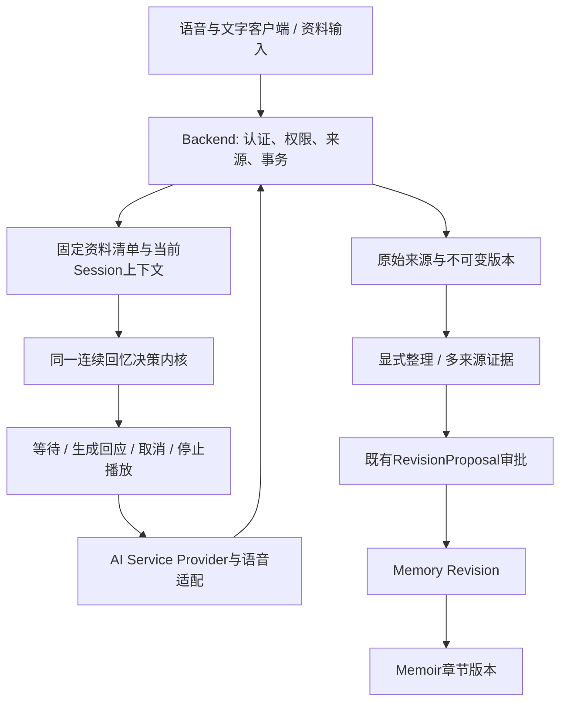
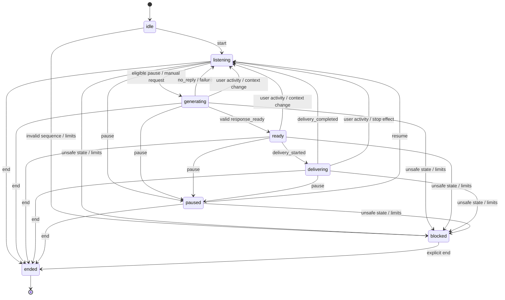

# Part 9.6-C — 连续回忆与多来源资料工程合同

## 0. Metadata 与授权

- 日期：2026-10-15，Asia/Shanghai。
- 基线：`master @ 0e39a39b22a72be361833dd0ae42c40f80146b1e`。
- 状态：C1 CONTRACT REVIEW PASS — PENDING USER APPROVAL；未批准实施。C-CR-E01/E02/E03/B01已在静态合同范围独立关闭；全产品后续工作包仍未冻结。审查过程与哈希见同目录独立审查报告。
- 本轮产物：仓库外合同及独立审查报告。项目文件、Git index、提交和远端保持不变；不运行应用、测试、数据库、Docker、迁移或 Provider。
- 9.6-B 已按用户确认范围封板。实现/文档基线 CI 38691707005 success，Fast642、普通PG48、B专项45/竞争11；本轮不复跑、不扩大证明范围。
- 层级：本文件给出完整产品目标、C1 可实施合同及后续接入设计约束。只有 C1 的范围可进入本次合同批准；真实语音、资料持久化、多来源审批和生产全链路均有后续门禁。
- C1 正式名称：**连续回忆决策内核（合成离线 profile）**。它不代表完整语音应用或已经支持真实日记资料。
- 本文件不是既有 9.5.5-C 隐私/删除 Design Freeze 的替代，也不修改旧 9.6-A/B 合同的历史事实。

## 1. 已确认产品决定

| ID | 决定 |
| --- | --- |
| P01 | 支持语音回忆、文字回忆及独立输入/粘贴的日记、笔记。语音与文字可在同一次回忆中使用。 |
| P02 | 默认轻陪伴：先自由讲述，结合前文、语义及停顿决定等待、附和或提一个问题；可切换仅记录。 |
| P03 | 不以固定几秒静默直接认定用户讲完。用户正在说话或输入时，不主动接话。 |
| P04 | 同一段持续静默最多主动回应一次：附和与问题二选一；之后等待用户。AI 自己说完、时间继续流逝不得重置额度。 |
| P05 | 用户重新开口，应停止 AI 播报，撤销待发布旧结果；旧回应不自动续播。支持暂停、跳过、结束。 |
| P06 | 原始录音、原始文字、转写、人工修订和回忆录分别保留版本与来源；不覆盖原文。 |
| P07 | 日记/笔记作为独立来源，不伪装成聊天消息；选中具体资料版本或资料集后，任务固定选择清单。 |
| P08 | 新增/修改资料不自动加入当前任务。选取不等于 Consent，也不扩大访问范围。 |
| P09 | AI 不无端补充经历、日期、地点或情绪；保留主观、不确定与矛盾，供人确认。 |
| P10 | 沿用 Owner 批准精确 Revision 的单一审批权威；附和、提问和工作摘要不成为讲述者事实。保存/结束回忆不自动触发正式 Memory。 |
| P11 | 真实 Provider 不自动重试；调用/计费未知单独记录 UNKNOWN，人工核对后才可明确新尝试。普通重放不能再调用。 |
| P12 | 一批 Candidate 任意一项非法则整批拒绝、零保存；不采用部分成功。 |
| P13 | 不额外持久化 Provider 原始请求/响应正文；日志、异常、tracing 不得成为正文副本。合法整理结果按业务 Revision 保存。 |
| P14 | 费用必填配置、预留预算、UNKNOWN 保留预留额、达到上限硬停止。Provider/模型、金额/币种、次数/token 上限与价格版本仍待确认。 |
| P15 | 真实个人资料、生产、C4/C6、备份/第三方删除传播及旧 UNKNOWN 限制保持；不能因合成测试放开。 |

文件上传、扫描/OCR、自动跨会话个人资料检索、家庭协作内容编辑入口不属于本次新增范围。既有 Family/Speaker/Consent/删除政策继续适用，不重新推定。

## 2. 实际代码约束与兼容原则

1. `services/ai-service/app/contracts.py` 的 v2 仅接受一条 `context_message_ids`；outcome 仅 question/no_question。Backend 镜像在 `app/schemas/interview_agent.py`。
2. v2 的持久化权威为 Backend `InterviewAgentState/Turn`；重放、epoch、旧结果作废及 Message 序号已存在，不能并行新建另一个生产 Session 权威。
3. `memory_workflow.py` 的 Batch/Candidate/ContentRevision/Memory 通过单 Message ID、复合 FK、CHECK 绑定；provider=mock、author_mode 含 mock_ai。不可只改 DTO 为列表或填假 UUID。
4. `SourceArtifact` 是未进入生产 metadata 的 C3 原型；kind 仅 Audio/Transcript/Segment/Message，结构要求 interview scope。无独立笔记/资料集/版本持久化体系。
5. C1 新建纯内核包，与 v1/v2 并存但不注册 Backend 入口。后续适配必须调用同一内核；Backend 仍负责认证、权限、内容读取、来源注册和事务。
6. 不把休眠 C3 或工作区未提交的 C3/BM-01 文件当成已可用依赖。保持已有 root/backend AGENTS、16项删除、ad、env、混合文档 C3 hunks 不变。

## 3. 分阶段交付与退出条件

| 工作包 | 内容 | 退出条件 |
| --- | --- | --- |
| C1，本次可审查 | 纯决策内核、严格 DTO、上下文引用、固定选择清单、合成文字及说话/停顿/输入/打断事件、确定性 Stub | 本合同 C01–C58、已有 AI Service 回归、静态独立实现审查通过；仍无真实语音/存储能力 |
| Backend 接入与资料基础 | Owner scope、持久状态适配、资料/版本/资料集/选择快照、C3 原地扩展、停止路径与删除范围 | 独立表/FK/index/ondelete/REST/迁移合同冻结及审批；隔离 HTTP/PG 验证 |
| 真实 Provider 与传输 | 专用合成验证入口、服务认证、真实调用 attempt、两个 UNKNOWN、费用预留/对账 | Provider/价格/数据处理能力和预算批准，网络验证专项授权；默认业务入口仍关闭 |
| 流式语音 | 合成音频 STT、TTS、VAD/语义轮次、播放/打断、原始音轨及时间位置 | 独立供应商与流式协议合同、延迟/识别/打断/断网/清理验收；真人录音另授权 |
| 多来源整理与回忆录 | 多来源 evidence、统一 RevisionProposal、精确 Memory Revision/章节引用、矛盾与上下文连贯性 | 扩展单来源业务链的显式迁移与兼容合同；C4/C6 能力先满足真人资料门禁 |

后四行是完整产品的接入计划，不是本次实施白名单。允许先做合成验证，不能宣称真人可用。不能以继续开发为理由放弃 C1 的复用要求。

## 4. 总体架构与权威



C1 只实现 CORE 及其输入/效果 DTO、上下文处理和 Stub。图中其他未实现节点为未来接入；不产生账号、Consent、SourceArtifact 或数据库。

### 权限矩阵

| 对象/动作 | Owner/account | Collaborator/Speaker | 内核 / Worker |
| --- | --- | --- | --- |
| C1 fixture | 测试角色元数据，无真实 JWT 或权限证明 | 仅合成 fixture 角色 | 只校验传入 scope 一致性，不授权 |
| 后续 Session/资料读取 | Backend 检查当前归属、来源和用途 | 遵循既定 C 权限；C1 不新增真实入口 | 不自行查询资料库 |
| 当前资料选择 | 显式选择有权使用的具体版本 | 不因有 Family 身份推定可用 | 清单不是授权；使用/发布重新核验 |
| 正式 Memory | 既有 Owner 精确 Revision 审批 | 纠错/修订按已冻结政策接入 | 不自动批准 |
| 撤回/删除 | 既定本人权利及 Owner Archive 边界 | 不要求 Owner 批准本人删除 | 安全停止优先；真实清除由 C6 |

## 5. C1 接口与严格 DTO

仅 Python 内部 API，无 REST/WebSocket 路由、SDK、网络、环境配置或数据库。

| 接口 | 输入 | 输出 | 约束 |
| --- | --- | --- | --- |
| `build_context` | Session fixture、不可变来源目录、SelectionManifest、最近对话、limits | ContextSnapshot | 确定性；先 scope/版本/许可模拟检查，再读正文 |
| `reduce_event` | DialogueState、Event、Policy、ContextSnapshot | Transition(next_state,effects,result) | 无 I/O、Provider、时钟/随机数读取，不修改原对象 |
| `run_effect` | 已预留的 GenerateEffect、ContextSnapshot、Stub | ReadyPayload/FailurePayload | 无seq/time/expected_version的绑定回调payload；独立于 reducer，只能明确注入离线 Stub，无动态注册/网络 |
| `envelope_callback` | 当前State、绑定callback payload、显式逻辑time_ms | Event | 使用当前last_seq+1/current version包装；不读时钟 |
| `validate_response` | Response 与原 GenerateEffect | 严格结果 | 逐字段绑定；非法不产生输出 |

所有 Pydantic DTO `extra=forbid/frozen/revalidate_instances=always`；数字 strict，拒绝 bool 当整数。集合使用 tuple；文本不以格式化为理由改写原文。无 hidden defaults 自动放行。

### DTO 字段规范（C1 内存数据，不是数据库表）

| DTO | 必需字段与类型 | nullable/不变性 |
| --- | --- | --- |
| `DialogueScope` | actor_user_id/family_id/family_member_id/interview_id/session_id UUID | 全部非空、冻结；当前fixture会话scope，不是认证主体 |
| `SourceScope` | owner_user_id/family_id/family_member_id UUID；origin_interview_id/origin_session_id UUID或NULL | 来源message两项非空；独立document可均NULL，不补造当前Session |
| `SourceVersionRef` | kind: message/document_version；entity_id/version_id UUID；version:int>0；source_scope:SourceScope；origin:user_text/voice_final/document | 不可变；voice_final仅合成；来源scope按§19.1投影比较 |
| `FixtureSource` | ref；text:str非空；availability:available/restricted；revision_fingerprint:str | 不可变；测试目录提供正文；无文件/环境读取 |
| `SelectionManifest` | id UUID；version>0；purpose:dialogue/extraction；ordered_refs tuple；scope | 固定版本清单；允许空；不含正文；禁止重复引用 |
| `SourceQuote` | ref；start/end:int；text:str | 0-based Python Unicode code point区间[start,end)；必须精确等于原文切片 |
| `SummaryEntry` | quote:SourceQuote；label:topic/person/time/uncertain/conflict | 只作可重建工作索引；不生成自由改写摘要或新事实 |
| `HistoryItem` | message/ref；role:user/assistant；delivery:none/started/delivered/interrupted；response_id可空 | AI/user角色不混用；interrupted不表示整段已送达或已被用户听懂 |
| `ContextSnapshot` | id UUID；scope；manifest_id/version；source_refs；recent_history；summary_entries；asked_keys；skipped_keys；context_revision>0 | 冻结；不读取未选择的历史资料，摘要不能单独成为来源 |
| `Policy` | version:str；complete_pause_ms/uncertain_pause_ms/max_events/max_sources/max_context_chars/max_history_items/max_summary_entries:int；mode:light/record_only | 全必填正值，complete<=uncertain；测试值不代表生产秒数 |
| `DialogueState` | scope:DialogueScope；contract_version=`reminiscence-dialogue.synthetic.v1`；policy_version；status/mode；version/epoch/last_seq/last_time_ms>=0；speaking/typing:bool；active_speech_turn_id/current_human_turn_id UUID或NULL；turn_cycles tuple；committed_refs/restricted_refs tuple；silence_cycle>=0/cycle_consumed:bool；silence_since_ms:int或NULL；semantic_hint:complete/incomplete/unknown；context_id/context_revision；pending_effect:GenerateEffect或NULL；ready_response/active_response:Response或NULL；known_requests/question_receipts/event_receipts tuple | 所有嵌套值冻结；§19定义关联、上限和写入时点；不是第二个生产AgentState |
| `Event` | event_id UUID；seq:int>0；time_ms:int>=0；scope；expected_version>=0；kind；按kind严格payload | kind为判别联合；无任意dict；调用方给逻辑时间，不能作为未来客户端权威 |
| `GenerateEffect` | effect_id/request_id UUID；scope；reservation_version；policy_version；epoch；context_id/revision；manifest_id/version；silence_cycle；trigger:auto/manual；allowed_outcomes tuple[ack/question/no_reply] | 所有值在预留转换中固定；响应完整echo；reservation_version不要求等于后续current version |
| `Response` | response_id UUID；完整effect绑定；outcome:ack/question/no_reply；text/question_key/topic_key可空；basis_kind:none/neutral/sourced；basis_quotes tuple | no_reply为空正文/key/topic/basis；ack固定中性短句；question须key/topic和有效引文或neutral |
| `QuestionReceipt` | request_id/response_id/epoch；question_key/topic_key/normalized_text；delivery:started/delivered/interrupted；basis_refs | started/中断不等于完整交付；§19.5规定写入时点 |
| `DeliveryReceipt` | request_id/response_id；policy_version/epoch；context_id/revision；manifest_id/version；kind:started/completed | 须匹配对应Response完整绑定，不能只看Session或response_id |
| `ReadyPayload/FailurePayload` | request_id及完整effect绑定；Response或固定error_code | 不含seq/time/expected_version，不含原异常或正文副本 |
| `Effect` | generate/cancel_generation/stop_playback/deliver/error 等判别联合 | 只是效果建议；C1不执行真实播放/取消/保存 |

Context 所有正文来源必须可由不可变ref目录重建；同ref却正文变化为契约错误。AI历史允许存于测试内存但不进入 SourceQuote 的user事实池。

## 6. 上下文与资料清单算法

1. 首版只自动读取当前 Session 对话；较早Session/日记/笔记只能作为显式选中来源。C1以合成资料目录验证，不建立自动全库检索。
2. 文本正文按既有稳定 message ID 模拟；日记按独立 document_version ID 模拟，不生成假 Message/Transcript/Artifact ID。
3. 清单按用户选择顺序冻结具体版本。资料集只在任务开始解析一次，展开为去重后的版本ref；随后资料集变更不影响旧manifest。
4. 资料集后续版本不追随latest。更换选择必须是显式 `replace_selection`，新manifest版本和context_revision，推进epoch、取消旧请求；使用新上下文是新任务边界，保留旧选择历史。
5. 最近对话按已分配的顺序排序，不用时间戳排序替代顺序；同sequence不同内容拒绝。
6. 最近窗口最多max_history_items。窗口外的用户来源用精确引文索引保留主题、未完成事项和矛盾；C1不调用模型生成摘要。来源与索引都无法放入限制时，返回CONTEXT_LIMIT并停止生成，不能静默丢失依赖。
7. 被跳过话题按显式topic key抑制；C1只证明键级去重，不宣称识别任意同义隐私话题。用户取消跳过须显式事件。
8. 每次生成前及结果交付前重验ref可用性、scope、manifest/context_revision。固定清单不冻结Consent；restricted、删除或权限改变须停止依赖处理。
9. C1的availability与scope来自可信fixture，客户端自行标记synthetic/available不是安全许可。真实Backend gate仍默认关闭，未来适配先核验权限，再构造DTO。

## 7. 事件、时间、静默与输入规则

### 事件集合

`start`、`speech_started`、`speech_ended`、`typing_started`、`typing_ended`、`user_message_committed`、`silence_elapsed`、`request_response`、`response_ready`、`response_failed`、`delivery_started`、`delivery_completed`、`pause`、`resume`、`set_mode`、`skip_topic`、`unskip_topic`、`replace_selection`、`source_restricted`、`end`。

speech_ended 的 semantic_hint=complete/incomplete/unknown 由合成夹具提供；C1不实现VAD、语义识别或用标点证明用户真实讲完。user_message_committed只引用稳定来源；语音 interim 不提交为事实。

### 顺序和幂等

- 每Session输入单序列seq=last_seq+1；time_ms单调不减；事件包含expected_version。每个新合法接收事件（含ignored回调/tick）version+1，epoch仅在输入/上下文/控制变化使旧结果失效时+1。
- 相同event_id与相同canonical fixture payload：返回原metadata，effects为空，不再调用Stub或交付。相同ID不同payload：EVENT_CONFLICT、状态不变、零效果。
- 未见过的旧seq、gap、时间倒退：不猜测顺序；进入blocked并返回固定错误和取消/停止效果。非法用户命令、STALE_VERSION及迟到回调按§19.3分类，不一概进入blocked。blocked只接受明确end；后续真实断线恢复另有合同，不在C1自动续接。
- 达max_events后blocked，不驱逐旧receipt重新执行；结果不包含原文。C1去重证据只存在同一内存实例，不能宣称进程崩溃后恰好一次。
- Event payload canonical digest仅处理合成fixture用于冲突比较，不能当未来真实资料的生产完整性/隐私方案。

### 静默周期

- start后先听；没有用户讲述时不因启动计时自动问开场问题，用户可主动request_response。
- 新用户发言speech_started或提交新user Message建立新周期；同一发言的speech_started和对应message commit必须共享human_turn_id，不能重复建立两个周期；turn_cycles去重和起点更新按§19.2。
- typing_started只表示忙碌并撤销旧回应；typing_ended不等于提交，不重置静默额度。若输入信号缺失，保持等待/blocked，不以超时猜测输入结束。
- speaking或typing任一为true时，禁止generate和deliver；两种输入可同时为true。
- 静默起点由独立silence_since_ms保存；任一输入活跃时为NULL，最后一项活动结束后才计时，tick/AI事件不移动起点。silence_elapsed引用current_human_turn_id/cycle；旧周期忽略。详见§19.2。
- complete达到complete_pause_ms时allowed_outcomes=(ack,question,no_reply)；incomplete/unknown达到uncertain_pause_ms时仅(ack,no_reply)。手动request仅(question,no_reply)，所有结果须落在原effect允许集合。
- 发出GenerateEffect之前原子设置cycle_consumed=true；no_reply、失败、取消也不自动退还额度。AI开始/结束输出、定时器重发、Provider失败均不得重置。
- request_response是用户明确操作，可单独申请一次新回应；不伪造新答案或新来源。暂停/仅记录下不生成，先明确resume/切换。
- resume不自动补发旧结果，也不自动重置持续静默额度；再次用户输入或手动请求后再响应。
- 具体秒数由显式Policy提供，合成测试可用短数值；不得写成已验证的真人默认值。

## 8. 状态机及打断



- mode=record_only保持来源入口概念开放，但所有主动generate/deliver为零；切模式推进epoch并取消/停止当前回应。C1不负责写来源。
- 新用户活动、pause/end、skip、replace_selection、source_restricted均使旧epoch失效，返回cancel_generation及stop_playback效果；后续response_ready须丢弃。
- delivery_started只证明测试适配器开始交付，不证明用户已听懂；delivery_completed仅证明交付完成。被打断的完整原回答不能记为完整已问问题。
- question从delivery_started起即记录key与标准化文本；完整completion才标记delivered。被打断的question_key也在本Session抑制自动重问，避免旧题自动续播；用户手动明确请求重复可在后续合同定义，C1不放行。
- ended为终态，不再生成/重放效果；后续继续回忆创建新Session。blocked不代表真实Interview已完成，也不自动删除任何来源。

## 9. 生成、交付、迟到和失败

1. reducer只预留一个pending request。已有pending/ready/delivering时不接受另一个自动生成；同Session多个请求模拟竞争通过expected_version拒绝旧事件，不宣称数据库并发已验证。
2. runner只接收明确注入的`OfflineDialogueProvider`；run_effect返回回调payload，envelope_callback才使用当前State封装有序Event。C1没有默认真实Provider、动态import或网络fallback；不读取API Key。
3. Stub生成的结果必须完整echo scope、request/epoch/context/manifest/cycle绑定。question为固定模板+可核验引文/中性开场；ack仅中性短句，不描述讲述者经历或情绪。
4. no_reply是合法结果，消耗本次自动回应机会，不生成空assistant内容。
5. validate后进入ready，deliver效果只引用response ID及内容；交付前仍需当前epoch和context一致、speaking/typing为false、mode=light且未paused/ended/blocked。
6. 中途输入只发取消/停止效果，不能证明真实供应商取消、零计费或音频已停止。真实语音适配须额外测停止延迟与缓存尾音。
7. C1固定错误：INVALID_EVENT、EVENT_CONFLICT、SEQUENCE_GAP、STALE_VERSION、CONTEXT_LIMIT、SOURCE_UNAVAILABLE、INVALID_RESPONSE、PROVIDER_FAILED。不得包含source正文或原始异常。
8. C1的失败只证明Stub/状态处理。未来真实外呼UNKNOWN与数据库COMMAND_OUTCOME_UNKNOWN分开记录，可同时存在；任何未知不得被普通replay、重启或新连接自动再调用。

## 10. 后续持久化数据设计约束（不属于C1建表授权）

| 实体 | 拟定职责和关键字段 | 必须冻结后才能实施 |
| --- | --- | --- |
| PersonalDocument | UUID、现有owner/family/member归属、kind=diary/note、当前版本指针、状态、UTC时间 | 资料是否必须归Interview、作者/录入者/故事主体表示、本人授权的用途scope；不得新建平行身份 |
| DocumentVersion | document_id、ordinal、原始正文、声明的资料日期/日期不确定性、版本来源、操作者、状态、UTC时间 | unique(document_id,ordinal)、版本FK/不可改写、清除例外、资料日期不等于created_at |
| SourceCollection/Item | collection UUID、owner/scope、成员版本ref、顺序、version | 并发更新、成员引用约束、删除/撤回影响；集合不是权限 |
| SelectionManifest/Item | 任务ID、固定有序version refs、purpose、policy/current permission证据、创建者、UTC时间 | actual source FK和C3接入；删除传播、statement-based snapshot及事务边界 |
| Conversation context | Session绑定、context_revision、摘要/引文依赖、epoch | 原地接现有AgentState/Turn，不造第二套生产会话权威；来源受限必须使上下文失效 |
| InvocationAttempt | Batch或Turn从属attempt、dispatch intent、provider request ID、配置版本、用量、状态 | 两类UNKNOWN、发送前提交、不可证明exactly once、只读对账、新尝试关联、无正文 |
| BudgetReservation/Entry | run/attempt、价格快照、币种、预留/结算/未知保留、次数/token限额 | 并发原子预留、金额decimal、不能按unknown=0、供应商能力、停止/清理证据 |

上述没有最终表名/DDL/FK/ondelete。本轮不能声称这些表已冻结或允许实现。C1不需要它们即可用fixture验证引用/交互算法；Backend持久化工作包实施前必须形成完整逐表规范和来源策略补充。

来源扩展必须原地接同一SourceArtifact/Provenance体系，显式处理现有kind/interview_scope CHECK，附加独立资料版本kind及正确归属约束；禁止用假Interview、假Speaker或假Consent填非空字段。无可验证身份/用途的历史内容保持受限。

## 11. 后续 REST/流式接入合同边界

以下是建议资源与语义，不注册路由、不作为当前API稳定承诺。完整路径、Schema、scope、事务与失败矩阵须在对应工作包冻结。

| 建议资源 | 操作 | 权限/重要失败 |
| --- | --- | --- |
| `/api/v1/documents`、`/{id}/versions` | POST/GET，新版另存 | account Owner与真实资料scope；来源/授权未知则内容不开放；PATCH不覆盖版本正文 |
| `/api/v1/source-collections`、`/{id}/items` | 显式选择与集合更新 | version/幂等/范围检查；旧manifest不跟随更新 |
| `/api/v1/sessions/{id}/source-selections` | POST固定manifest | 来源逐项当前授权；跨scope拒绝；用途不因选中自动同意 |
| `/api/v1/sessions/{id}/dialogue-events`、`/dialogue-state` | 有序控制/只读状态 | current Owner、expected_version、幂等；重复不再生成；客户端时间和静默标记不作为最终权威 |
| 独立的流式连接 | 音频/partial/final/播放状态 | 短期凭据、连接代次、音频序号、断线重连、回放防护、服务端权威计时、暂停/打断优先级 |
| 专用合成验证任务 | 创建/执行/状态/只读对账 | 服务端登记fixture与隔离资源；不能靠synthetic=true或普通Owner身份放行 |

普通业务入口、默认Provider及真实处理保持关闭。AI Service不可直接读Backend数据库或自行批准Consent。后续HTTP认证/超时/连接错误与SDK自动重试必须显式冻结；不沿用旧5秒保证或凭Stub抛异常声称真实deadline。

## 12. 两类 UNKNOWN、预算及正文最小化

- Provider UNKNOWN：可能已接收/生成/计费；数据库提交 UNKNOWN：可能已落库。分别核对，互不替代。
- 发送意图持久提交未确认不得发送；已发送或可能发送后未知，保留费用预留，禁止自动重发。取消不代表供应商已取消或不收费。
- 人工新尝试必须新attempt标识、关联旧尝试、重新检查额度；业务幂等重放仍返回旧结果。不得用新key隐式规避未知或预算。
- 价格记录必须绑定provider/model/region/currency/计费区间/输入输出及其他收费项/核验日期/来源；项目价格快照ID不冒称官方版本号。
- Provider和模型仍待用户选定。此前Qwen方案及20元/100次等只是建议，不是已批准生产/验证值。
- 调用前预留可证明上限；无法核验计价或限额时拒绝调用。并发预留不得双花；UNKNOWN不释放；变更价格/model不自动生效。
- C1没有真实调用或计费，billing=not_applicable，不构造假Provider usage或费用0凭证，也不实现空转预算平台。
- C1全部文本/状态仅存在测试内存，不做文件/日志正文记录；后续调用记录保留必要元数据，合法业务Revision仍保留有源内容。Provider自身留存、缓存和删除能力需另核验。

## 13. C1 精确文件白名单（候选11路径，全部新增）

1. `services/ai-service/app/dialogue/__init__.py`
2. `services/ai-service/app/dialogue/contracts.py`
3. `services/ai-service/app/dialogue/context.py`
4. `services/ai-service/app/dialogue/controller.py`
5. `services/ai-service/app/dialogue/provider.py`
6. `services/ai-service/app/dialogue/mock.py`
7. `services/ai-service/app/dialogue/runner.py`
8. `services/ai-service/tests/test_dialogue_contracts.py`
9. `services/ai-service/tests/test_dialogue_context.py`
10. `services/ai-service/tests/test_dialogue_controller.py`
11. `services/ai-service/tests/test_dialogue_runner.py`

这是实施候选，独立合同审查需核对路径冲突。不得新增依赖、改pyproject、改现有v1/v2/Memory文件、Backend代码、Models/Migration、workflow或资料文档。后续文档同步另列精确清单和授权。若需要改白名单才能满足合同，先说明最小修订并再审。

## 14. 数据库/迁移/历史兼容

- C1数据库变更=0，Migration源码=0，数据库执行=0，不注册Metadata，不触碰普通删除API。
- 独立合成profile不读取或升级现有Agent行。旧v1/v2和B migration链、默认关闭门禁、既有审批结果均保持。
- Backend接入时追加迁移、禁止改历史migration；明确版本化Agent合同与现有State/Turn兼容，不自动把历史数据/授权认成新版。
- 多来源阶段必须逐表说明：现有单sourceFK/复合FK/CHECK如何保留或升级、稳定来源、immutable revision、旧JSON/HMAC绑定、候选/Memory/Memoir版本、rollback/downgrade保护；不得直接把单ID换成列表。
- 资料策略不明或历史授权不明时fail closed，不能自动补为Owner本人。C4/C6门禁及User/Family删除政策不因本合同变化。

## 15. C1 验收矩阵（未来验收，不是已执行结果）

| ID | 必须断言 |
| --- | --- |
| C01 | DTO额外字段、bool/int、空白及非法长度拒绝 |
| C02 | 输入/State/Context不可改写，转换前后原对象一致 |
| C03 | scope不一致不读取/输出该来源正文，不产生生成效果 |
| C04 | start默认light，未讲述不自动开场 |
| C05 | speaking=true零生成/交付 |
| C06 | typing=true零生成/交付，typing_end不伪装提交 |
| C07 | 同时说话与输入，任一未结束均阻止回应 |
| C08 | complete未到阈值继续等待 |
| C09 | complete到阈值仅一次ack/question/no_reply |
| C10 | incomplete/unknown不提前追问，长停顿仅中性ack/no_reply |
| C11 | 同cycle多次tick、AI开始/结束不重复回应 |
| C12 | speech_started与对应Message共享human_turn_id，只重置一次 |
| C13 | 新用户turn才重置自动静默额度；typing_end不重置 |
| C14 | Stub no_reply后继续静默不再调Stub |
| C15 | Stub失败/取消后不自动重试/退还静默额度 |
| C16 | 手动request可用，无新原文不造新答案 |
| C17 | 相同event重放effects为空、Stub调用次数不变 |
| C18 | 相同ID不同payload拒绝，错误无正文 |
| C19 | seq gap/旧未见seq/时间倒退进入blocked并停止 |
| C20 | expected_version过期不接受第二个生成 |
| C21 | record_only零主动生成/交付，来源输入概念不受限 |
| C22 | pause取消生成/停止交付，resume不补发/自动重置 |
| C23 | end终态；重放不发布，继续回忆须新Session |
| C24 | generating时用户开口，旧epoch结果不交付 |
| C25 | ready时开始输入，旧输出不交付 |
| C26 | delivering时用户开口产生stop效果；旧内容不自动续播 |
| C27 | response_ready逐字段错误绑定均拒绝 |
| C28 | pause/end之后迟到result、delivery_ack不复活旧任务 |
| C29 | 已完整交付问题key与规范化文本不自动重问 |
| C30 | interrupted问题抑制自动重问，不冒称完整已听见 |
| C31 | ack无事实basis/情绪断言；question只能中性或精确来源引文 |
| C32 | AI历史/摘要不进入讲述者事实池 |
| C33 | 对否定/不确定/矛盾来源使用原引文，不补日期/经历 |
| C34 | 最近对话有序，窗口裁剪后工作索引仍可追溯 |
| C35 | 引文start/end/text逐项匹配；同ref换正文拒绝 |
| C36 | 超上下文/来源/事件上限停止；不静默丢来源或重放旧效果 |
| C37 | 未选择的其他Session/日记不读不输出 |
| C38 | 清单固定资料版本，新增版本/资料集成员不自动进 |
| C39 | 显式replace_selection推进epoch，旧结果作废 |
| C40 | 已选来源变restricted后取消依赖生成，发布前仍拒绝 |
| C41 | skipped topic不再自动提问；显式unskip后才解除 |
| C42 | document_version保持独立身份，不造Message/Artifact |
| C43 | runner无默认Provider/网络fallback，未注入则固定拒绝 |
| C44 | reducer与context无Provider调用、I/O、真实时间和随机数读取 |
| C45 | no_reply/失败零deliver，错误/tracing不复制正文 |
| C46 | fixture可精确重放，效果ID由入参稳定派生而非隐式随机 |
| C47 | 既有Interview Agent与Memory Extraction AI Service测试全部保持 |
| C48 | import边界/静态差异确认Backend/DB/SDK/网络/生产配置均未接入 |
| C49 | 同Family/Member显式旧Session来源保留原scope可用；未选拒绝 |
| C50 | 无Interview/Session的document_version可作为选中fixture；不补假ID，跨Family/Member拒绝 |
| C51 | extraction用途manifest不用于对话；Policy版本变化拒绝 |
| C52 | 多tick不移动silence_since_ms；语音start/end/commit同turn只建一个cycle |
| C53 | 生成中间合法tick推进version后，匹配reserved binding结果仍可接受 |
| C54 | pause/resume/新请求后旧ready/failed/delivery回执为ignored，不blocked、不完成新输出 |
| C55 | 不同key同标准化问句去重；started打断标interrupted而非delivered；未开始ready丢弃不造交付 |
| C56 | scope/seq/time合法的用户停止动作不被旧expected_version拒绝；只有终态控制保留专用容量 |
| C57 | source_restricted后同一旧Context不能再次生成；重建排除受限来源后才继续，旧结果仍丢弃 |
| C58 | 普通tick/callback不能偷偷替换Context；commit/显式选择替换按单调revision重建且包含真实对应来源 |

### 将来获批准后的验收命令

工作目录：`services/ai-service`，使用项目现有Python环境；不能为了运行测试自动安装/下载依赖。

```text
python -m pytest tests/test_dialogue_contracts.py tests/test_dialogue_context.py tests/test_dialogue_controller.py tests/test_dialogue_runner.py -q
python -m pytest -q
python -m ruff check app tests
python -m ruff format --check app tests
```

若本机工具环境缺失，只报告并给替代建议，不能改变环境/项目依赖来扩大范围。C1不运行Backend Fast/HTTP/PG；这些代码没有接入，不能用本轮结果覆盖其历史状态。

## 16. 证据与本次审查边界

- C01–C58逐项映射代码、测试节点、实际运行证据，不能按总passed数推定全部覆盖；当前全部NOT RUN。
- 合成事件只证明状态转换、引用与取消效果；不证明真实停顿识别、语义理解、真人连贯性、服务端认证、声音已停止、跨进程并发或付费幂等。
- 真人测试指标应另定：误打断率、恢复/尾音延迟、转写错误、长停顿体验、上下文错用、事实增补、问句重复；不在C1虚构通过阈值。
- 专项HTTP、PostgreSQL16.15与Manager/Runner分离保持既有政策，日后任务单独授权；旧未知资源不复用/不清理。

## 17. ADR与文档后续要求

1. 新增9.6-C产品范围与C1合同SSOT；旧9.6-A P03/P04作为历史，另列新合同适用边界，不回写为已完成。
2. ADR-008/009涉及工作摘要/多来源及隐私边界时，先补具体设计再讨论状态，不人为全部Accepted。
3. C3扩展、资料身份/版本/用途、同一审批权威及删除传播需要对应正式补充；不自动关闭ADR-002/007、BM-01、C4/C6。
4. README/路线图/日志后续仅同步审查事实和范围，禁止把C1内核写成真实语音/日记/多来源回忆录完成。

## 18. 冻结状态及真正待决项

- 已确认：P01–P15产品方向；C1采用离线合成内核的实施候选；不授予代码/文档归档/Git/网络/数据库操作。
- C1需要工程独立审查：事件/交付边界、严格DTO、清单失效、时钟、上下文、有限状态及精确白名单；本草案尚未宣称PASS。
- 全产品后续阻塞：独立资料的scope/作者与Consent连接；C3持久来源与多来源B兼容；真实Provider/预算/数据能力；真实流式播放和断线协议。这些不能被C1内存ref替代。
- 具体语音秒数和Provider价格值不是C1逻辑验证阻塞，但缺生产值和能力核验不得真实执行。
- 下一步：独立合同审查→修订闭环→用户批准C1精确11文件实施→离线验收→独立实现审查→文档与Git分别授权。遇到改变产品/授权语义的问题，提交用户决定。

**初稿状态：DESIGN DRAFT / IMPLEMENTATION NOT AUTHORIZED。**


## 19. 初审修订后的规范性细则

本节与§5/§7/§8/§9共同构成当前合同；对应初审缺口已在原段落同步修订，旧稿另行保留。以下字段和算法必须实现，不允许仅靠注释或测试driver隐含维持状态。

### 19.1 来源scope和用途（C-CR-B01）

- SourceScope的owner_user_id/family_id/family_member_id在本fixture profile必须分别等于DialogueScope的actor_user_id/family_id/family_member_id。此为合成输入一致性约束，不是未来真实作者/Speaker/Consent规则。
- 自动当前会话message还须origin_interview_id和origin_session_id匹配当前值；显式manifest可引用同Family/Member的较早Session，保留原origin值，不改填当前Session。
- 独立document_version的origin Interview/Session允许均NULL；不造Message/Artifact/Interview ID。一个NULL一个非NULL的document来源在C1拒绝，实际真实来源接入后再冻结。
- build_context/reduce_event/run_effect仅接受purpose=dialogue。extraction manifest固定拒绝，不把选同一资料视为用途互通。

### 19.2 逐类payload与轮次（C-CR-E01）

| kind | payload与确定性规则 |
| --- | --- |
| start/pause/resume/end | 空payload；end仅终结内核，不自行更新真实Session |
| speech_started | human_turn_id UUID；设置active_speech_turn_id。已有同ID活动不另开cycle；正在speaking却换新ID拒绝 |
| speech_ended | human_turn_id UUID、semantic_hint；ID匹配active_speech_turn_id；speaking=false、active ID=NULL |
| typing_started/typing_ended | 空payload；只改typing，不造turn/Message；输入结束不等于提交 |
| user_message_committed | human_turn_id、message_ref、semantic_hint；ref是当前Session的user_text/voice_final且在目录中；不允许document；同ref不重复提交 |
| silence_elapsed | human_turn_id、silence_cycle；等于当前周期；持续时长只由time_ms-silence_since_ms计算 |
| request_response | 空payload；明确请求一个问题，allowed_outcomes=(question,no_reply) |
| response_ready/response_failed | ReadyPayload/FailurePayload |
| delivery_started/completed | DeliveryReceipt |
| set_mode | mode=light/record_only |
| skip_topic/unskip_topic | 非空受控topic_key；仅键级抑制 |
| replace_selection | 同DialogueScope的已验证新ContextSnapshot，manifest version/context_revision递增，purpose=dialogue |
| source_restricted | 已知SourceVersionRef；不相关ref为ignored，不读额外正文 |

turn_cycles是不可变(human_turn_id,assigned_cycle)记录；第一次speech_started或纯文字commit遇新ID才cycle+1、current_human_turn_id=该ID、cycle_consumed=false。同ID的语音final commit不重置cycle；未知语音commit无对应turn记录则拒绝。纯文字commit使用新human_turn_id并显式semantic_hint，不根据键盘活动造turn。committed_refs独立记录已提交ref，重复ref的新事件拒绝，不能借新事件ID重新开静默周期。

任何speaking/typing活动开始：silence_since_ms=NULL、epoch+1，撤销旧请求/输出。只有当前human_turn的speech_ended/user_message_committed可更新当前semantic_hint；若任一活动仍true，起点保持NULL；两者均false才设置起点为本事件time_ms。typing_ended在所有活动结束时恢复起点，但不改hint、turn、cycle或额度。tick和AI相关事件不能更新起点。两个输入交叠时按最后活动结束计时。已知较早turn的final commit只更新该turn的来源记录、上下文和epoch，不得覆盖当前turn的semantic_hint、silence_since_ms、cycle或cycle_consumed；需要保留旧语义时存入对应turn记录。旧turn的speech_ended同样不能覆盖较新current_human_turn的语义；若它恰是最后结束的输入活动，可设置当前静默起点，但保持较新turn的hint不变。

C52必须包含交错链：A complete结束→B开始且incomplete结束→A迟到final commit(complete)→B的短/长阈值tick；B的hint保持incomplete，短阈值零提问，长阈值仅ack/no_reply，A commit不移动B已有静默起点或恢复额度。

State必须保留turn_cycles、committed_refs、restricted_refs、known_requests、question_receipts和event_receipts；它们各自最多max_events项。达到任一容量进入blocked并撤销生成/交付，不驱逐旧项以重执行。为end保留一份独立terminal_receipt，blocked达到容量后仍可明确end；总内存界限为上述有限集合+一个terminal receipt。无正文的相同event replay返回原metadata；ended中除已知replay外的新事件固定拒绝，无效果。

### 19.3 版本和回调分类（C-CR-E02）

检查优先级：schema与DialogueScope→已知event重放→seq/time→回调请求关联→expected_version→转移。scope不匹配、EVENT_CONFLICT、STALE_VERSION、非法用户命令固定拒绝，状态不变且零生成/交付。seq gap/未见旧seq/time倒退进入blocked并取消/停止。旧silence cycle的tick消费为ignored，不改silence_since_ms或额度。

run_effect只返回自身完整绑定的payload，无当前seq/time/version。测试驱动器调用纯envelope_callback(current_state,payload,time_ms)，使用当前last_seq+1/current version封装event；回调完整绑定中reservation_version仍是原值。中间tick推进current version不使匹配pending失效，验证时对照State.pending_effect。

known_requests保存所有已预留GenerateEffect。已知旧request或旧epoch的结构正确ready/failed/delivery回调消费为ignored：接收seq/time/version+1，零效果，不改新pending/ready/active，不进入blocked。未知request或伪造绑定固定拒绝。曾完成/作废请求的后续正确回执也ignored，不重新交付。匹配的当前callback仍须current expected_version；调度器必须用当前state封装，不能复用旧event envelope。

安全停止例外：scope/seq/time合法的speech_started、typing_started、pause、end、set_mode=record_only、source_restricted即使expected_version过期也作用于当前State，推进epoch并撤销旧输出；不得因乐观版本落后忽略用户停止。此例外不增加正文读取或生成权。resume、切light、手动请求、选择替换和其他命令必须current expected_version。C1只证明此单实例逻辑，不证明真实并发连接/发布事务。

### 19.4 标识和状态关联（C-CR-E03）

- request_id=uuid5(session_id,`generate:{event_id}`)，response_id=uuid5(request_id,`response`)，effect_id=uuid5(request_id,效果kind)。不读随机数，也不生成Source身份。一个request仅一个完整Response。
- Policy.version固定于State实例，和GenerateEffect/Response/Receipt完整绑定；不允许同实例热换Policy。参数应相同版本同值，不同值同version也拒绝（State保留Policy不可变值或其合成canonical digest）。
- 预留前保存pending_effect至State及known_requests；一Session至多一pending。ready后保存完整ready_response；delivery_started把该对象移至active_response；完成/作废后清空对应对象，known_requests保留关联元数据。
- Result必须echo scope/request/reservation_version/policy/epoch/context ID+revision/manifest ID+version/cycle/trigger/allowed_outcomes。response_id须符合固定派生；outcome须在allowed_outcomes集合。delivery receipt绑定request/response/policy/epoch/context/manifest，且对应ready或active对象。
- run_effect本身不保存另一个权威状态；测试驱动器只消费新Transition.effects一次，不重执行回放返回的空effects。明确重复直接调用run_effect仍是调用方错误，C1不宣称任意调用或进程崩溃下物理exactly-once。Provider失败不由runner循环重试。

### 19.5 输出和去重时点（C-CR-E03）

- ready未开始交付不写question receipt；该ready因输入/停止丢弃时，不声称用户已听见，也不自动补发。
- delivery_started校验完整binding后，写QuestionReceipt(delivery=started)，保存question_key/topic_key及normalize(text)。normalize为Unicode NFKC、casefold、去空白及Unicode标点；原文不被覆盖。
- 仅匹配active_response的delivery_completed把receipt标为delivered；旧输出completion不能完成新输出。
- active被用户活动/停止打断，receipt标interrupted；started/interrupted/delivered均阻止同key或相同normalized_text自动重问，interrupted不等于完整已问/已听懂。skip_topic按topic_key匹配。
- ack无question receipt，且只允许中性固定短句、basis_kind=none、无引文；no_reply为空文本/key/topic、basis_kind=none。question必须key/topic；neutral须无basis，sourced必须每个引文精确匹配用户来源。AI来源及summary自身不能作事实basis。

### 19.6 受限来源与Context更新（主审补充澄清）

- source_restricted对当前或已知请求依赖的ref加入State.restricted_refs，推进epoch、撤销生成/交付。后续相同ref始终不得重新进入C1上下文；无自动re-consent或恢复逻辑。
- reduce_event每次生成及交付前检查Context.source_refs与restricted_refs不相交。仅取消一次但随后用旧Context重新生成不合格；当前资料含受限依赖时SOURCE_UNAVAILABLE，继续接收用户活动与停止命令，不读取其正文。
- 普通tick/callback/control传入Context的id/revision必须匹配State，不允许靠换函数参数偷偷注入新资料。user_message_committed允许重建context_revision恰为旧值+1，同manifest且带真实提交message_ref；replace_selection用已验证新manifest、context_revision恰为旧值+1。不改变旧refs归属或正文。
- 重建Context必须删除受限ref、依赖它的引文/摘要项和旧AI工作内容；只有其余来源通过fixture可用性/scope/用途校验后才接受，并推进epoch。不改变原始来源或宣称已执行删除传播。C1不提供清除restricted_refs的恢复入口。
- 无关source_restricted事件消费为ignored，不能让任意未知ref触发读取；这仍不是对真实撤回/删除的授权或执行实现。

## 20. 本次修订对照

| 初审发现 | 修订位置 | 目标验收 |
| --- | --- | --- |
| C-CR-E01 轮次与静默字段 | §5/§7/§19.2 | C05–C15/C52 |
| C-CR-E02 回调与版本冲突 | §5/§7/§19.3 | C17–C28/C53/C54/C56 |
| C-CR-E03 交付/去重关联 | §5/§8/§19.4/§19.5 | C27–C30/C55 |
| C-CR-B01 来源scope混用 | §5/§19.1 | C03/C37–C42/C49–C51 |

修订不新增产品政策、不扩大11文件白名单，不接真实来源、权限或Provider。只有独立定向复审可以确认发现项在合同范围关闭。
